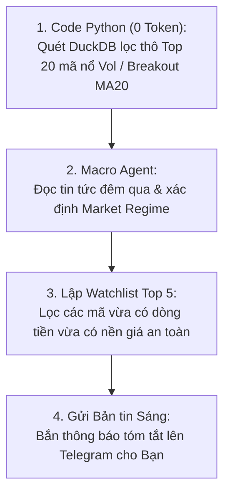

# WORKFLOW 01: BẢN TIN TIỀN THỊ TRƯỜNG (MORNING BRIEFING - 08:00 AM)

---

## 1. MỤC TIÊU
Chuẩn bị tâm thế và danh sách cổ phiếu tiềm năng (Watchlist) trước khi phiên giao dịch mở cửa lúc 09h00.

---

## 2. QUY TRÌNH THỰC HIỆN TỪNG BƯỚC

### Bước 1: Lọc Thô Kỹ Thuật Bằng Code (0 Token)
* Chạy script `parquet_mgr.scan_breakout_vol_candidates()` trên file `market_history_5y.parquet`.
* Lọc ra các cổ phiếu:
  * Khối lượng phiên gần nhất $> 1.2$ lần trung bình 20 phiên.
  * Giá đóng cửa nằm trên đường MA20.
  * Thanh khoản trung bình $> 50.000$ CP/phiên.

### Bước 2: Macro Agent Đánh Giá Xu Hướng Thị Trường
* Cập nhật tin tức vĩ mô (Tỷ giá, lãi suất, chứng khoán thế giới).
* Đưa ra chỉ số tâm lý: *Bullish / Neutral / Risk-Off*.

### Bước 3: Xuất Bản Tin Sáng
* Gửi tin nhắn Telegram ngắn gọn cho Bạn lúc 08h30:
  > *"Chào buổi sáng Bác! Hôm nay trạng thái thị trường NEUTRAL. Watchlist ưu tiên theo dõi: HPG, SSI, FPT."*
