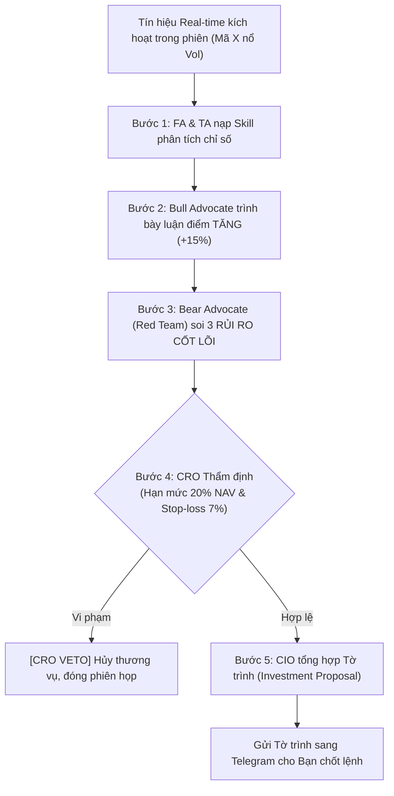

# WORKFLOW 02: HỌP HỘI ĐỒNG ĐẦU TƯ & TRANH BIỆN (INVESTMENT DEBATE)

---

## 1. MỤC TIÊU
Thẩm định toàn diện một cơ hội đầu tư bằng cơ chế phản biện đối kháng (Adversarial Debate) giữa **Phe Bò (Bull)** và **Phe Gấu (Bear)** để triệt tiêu thiên kiến FOMO.

---

## 2. QUY TRÌNH TRANH BIỆN TỪNG BƯỚC

### Bước 1: Thu thập Dữ liệu & Báo cáo FA/TA
* TA Agent xác định: Vùng giá mua tối ưu, điểm cắt lỗ kỹ thuật, kháng cự mục tiêu.
* FA Agent kiểm tra: Sức khỏe BCTC, nợ vay D/E, khoản phải thu, định giá P/E.

### Bước 2: Phe Bò (Bull Agent) Trình Bày
* Đưa ra các chất xúc tác (Catalysts) ngắn hạn có thể kéo giá tăng ít nhất 15%.

### Bước 3: Phe Gấu (Bear Agent) Phản Biện
* Bắt buộc vạch trần ít nhất 3 rủi ro cốt lõi (Bẫy bull trap, rủi ro pha loãng, thanh khoản khi thị trường sập).

### Bước 4: Giám Đốc Rủi Ro (CRO) Thẩm Định
* Tính toán Position Sizing: Số lượng cổ phiếu tối đa được phép mua (đảm bảo $< 20\%$ NAV).
* Khóa cứng mức Stop-Loss (tối đa -7.0%).

### Bước 5: Giám Đốc Đầu Tư (CIO) Ký Tờ Trình
* Tổng hợp biên bản và gửi thông báo Telegram cho Bạn kèm các nút bấm tương tác.
