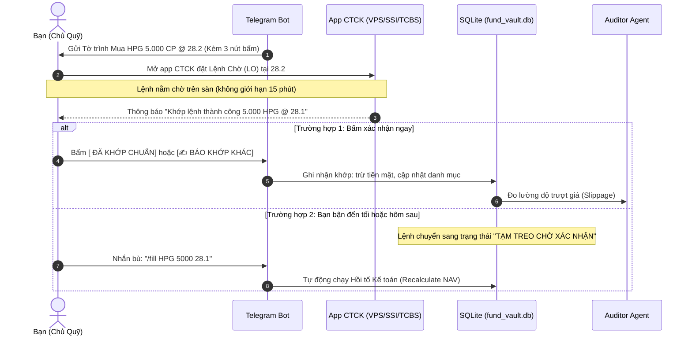

# WORKFLOW 03: QUY TRÌNH THỰC THI LỆNH & ĐỐI SOÁT (ORDER EXECUTION & RECONCILIATION)

---

## 1. MỤC TIÊU
Đảm bảo luồng giao dịch bán tự động (Semi-Autonomous) diễn ra trơn tru, bảo mật tuyệt đối SmartOTP của Bạn và hạch toán đúng giá khớp thực tế.

---

## 2. QUY TRÌNH THỰC THI CHI TIẾT

### Các Hành Động Chính:
1. **Bạn Đặt Lệnh Trên App:** Đặt lệnh Giới hạn (LO) tại vùng giá đề xuất.
2. **Khớp Lệnh Thực Tế:** 
   * Nếu khớp đúng $\to$ Bấm nút `[✅ ĐÃ KHỚP CHUẨN]`.
   * Nếu khớp lệch giá/khối lượng $\to$ Nhắn `khớp HPG 5000 giá 28.1` hoặc gõ `/fill`.
3. **Kế Toán Tự Động:** Hệ thống trừ tiền mặt, tính phí CTCK 0.15%, tính giá vốn bình quân mới cho cổ phiếu.
