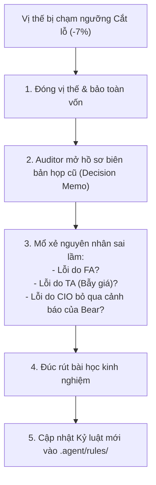

# WORKFLOW 05: KHÁM NGHIỆM THẤT BẠI & TIẾN HÓA HỆ THỐNG (POST-MORTEM AUDIT)

---

## 1. MỤC TIÊU
Khi một thương vụ bị dính Stop-Loss (-7.0%), kích hoạt ngay quy trình điều tra độc lập để tìm ra nguyên nhân gốc rễ và cập nhật bài học vào Rules nhằm giúp Quỹ không bao giờ lặp lại sai lầm.

---

## 2. QUY TRÌNH ĐIỀU TRA 4 BƯỚC

### Bước 1: Rà Soát Biên Bản Họp Cũ (Decision Memo)
* Auditor Agent trích xuất lại biên bản cuộc họp lúc quyết định mua mã này:
  * *Phe Bò đã đưa ra những luận điểm gì? Tại sao các luận điểm đó không diễn ra đúng như dự báo?*
  * *Phe Gấu lúc đó đã cảnh báo rủi ro gì? Rủi ro dẫn đến việc dính Stop-loss hôm nay có phải chính là điều Phe Gấu đã chỉ ra trước đó không?*

### Bước 2: Phân Loại Nguyên Nhân Thất Bại
1. **Lỗi Thiên Nga Đen (Unforeseen Event):** Do sự kiện bất khả kháng vĩ mô toàn cầu hoặc tin bắt bớ bất ngờ.
2. **Lỗi Kỹ Thuật (TA Trap):** Dính bẫy giá giả (False breakout) do dòng tiền lớn xả hàng.
3. **Lỗi Thiên Kiến Lạc Quan (Confirmation Bias):** CIO và Bull Agent đã phớt lờ các cảnh báo về nợ vay hoặc thanh khoản của Bear Agent.

### Bước 3: Cập Nhật Tiến Hóa Hệ Thống (Self-Improvement)
* Viết bản **"Post-Mortem Memo"** lưu vào thư mục `storage/journals/`.
* Bổ sung quy tắc mới vào `.agent/rules/risk_limits.md` (ví dụ: *Từ nay cấm mua breakout nếu khối lượng phiên trước đó có dấu hiệu phân phối*).
