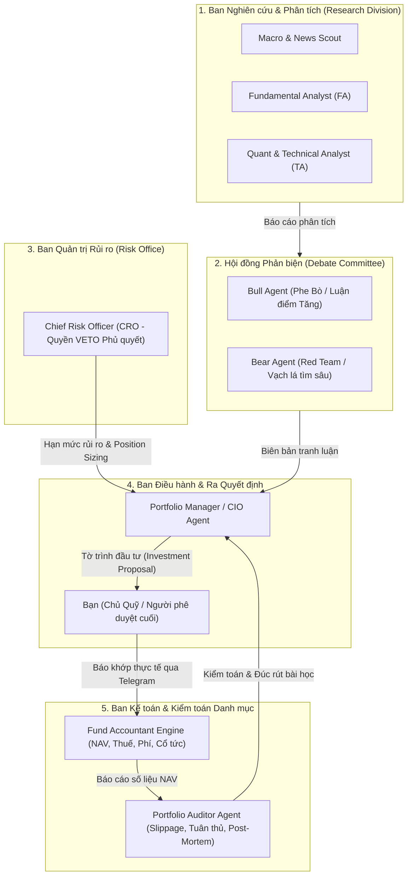
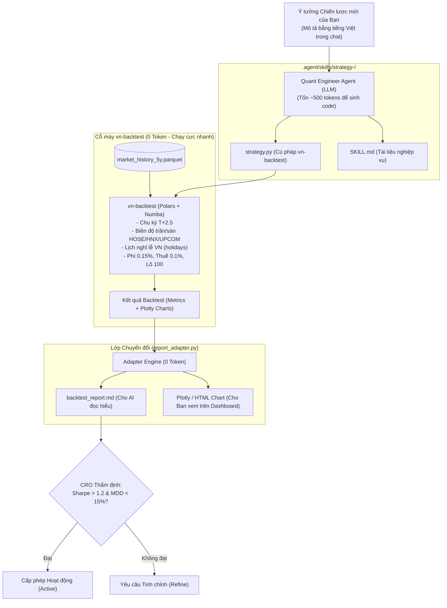

# BẢN THIẾT KẾ KIẾN TRÚC TOÀN DIỆN (SYSTEM BLUEPRINT)
# CÔNG TY QUỸ ĐẦU TƯ CHỨNG KHOÁN CÁ NHÂN AI (AI PERSONAL INVESTMENT FUND)

---

## 1. TỔNG QUAN KIẾN TRÚC & TRIẾT LÝ VẬN HÀNH

### 1.1. Sứ mệnh của Quỹ
Xây dựng một hệ thống Quỹ đầu tư định lượng cá nhân vận hành tự động theo mô hình **AI-Native Multi-Agent**, hoạt động trên **Thị trường Chứng khoán Việt Nam (HOSE, HNX, UPCOM)**. Hệ thống kết hợp giữa tính toán định lượng tốc độ cao (Deterministic Code) và tư duy suy luận chiến lược sắc bén (AI Reasoning), đảm bảo kỷ luật tuyệt đối và tối ưu hóa chi phí vận hành (tiệm cận 0 Token cho các tác vụ thường nhật).

### 1.2. Ba Trụ Cột Thiết Kế
1. **Phân tách Rạch ròi Giữa Code và Token (Cost Optimization):**
   * *Code Python & Database (Chi phí = 0 Token):* Quét 1.600 mã, ghép nến real-time, tính toán chỉ báo kỹ thuật, chạy backtest 5 năm, chốt sổ kế toán NAV, hiển thị biểu đồ Dashboard và phản hồi lệnh Telegram.
   * *AI LLM Reasoning (Chi phí tối thiểu):* Chỉ kích hoạt khi cần phân tích chuyên sâu, phản biện đa chiều (Bull vs Bear debate) và ra quyết định đầu tư tại Hội đồng Đầu tư.
2. **Hạ tầng Dữ liệu Hybrid Cloud-Edge:**
   * Tận dụng kho dữ liệu EOD của 1.600 mã được Cloud Run tải vào **Google BigQuery** lúc 20h30 hàng ngày.
   * Đồng bộ 1 lần duy nhất về máy thành file **Parquet 5 năm (~35 MB, 2 triệu dòng)** để xử lý offline siêu tốc bằng **DuckDB / Polars**.
3. **Con người Giữ Quyền Sinh Sát (Human-in-the-Loop):**
   * Do đặc thù bảo mật SmartOTP tại các CTCK Việt Nam, AI đóng vai trò **Copilot (Trợ lý cấp cao)**: Phân tích, phản biện, đề xuất khối lượng/giá và gửi lệnh đến Telegram. Bạn là người chốt lệnh trên app CTCK và báo khớp để hệ thống tự động kế toán.

---

## 2. CƠ CẤU TỔ CHỨC CÁC PHÒNG BAN & AI AGENTS



### Chi tiết Nhân sự AI:
* **CIO / Portfolio Manager Agent:** Chủ tọa hội đồng, tổng hợp ý kiến, cân đối vĩ mô và ban hành Tờ trình đầu tư cuối cùng gửi cho Bạn.
* **Macro & Market Sentiment Agent:** Đo lường sức khỏe vĩ mô (Lãi suất, tỷ giá USD/VND, lạm phát, dòng tiền khối ngoại) để xác định trạng thái thị trường (*Bullish / Sideway / Risk-Off / Downtrend*).
* **Fundamental Analyst (FA Agent):** Đọc BCTC, phát hiện bất thường kế toán (khoản phải thu, tồn kho ảo), tính định giá DCF, P/E, P/B.
* **Quant & Technical Analyst (TA Agent):** Tìm điểm vào lệnh dựa trên hành động giá (Price Action), dòng tiền (VSA), hỗ trợ/kháng cự.
* **Bull Agent (Phe Bò):** Xây dựng luận điểm tăng giá sắc bén nhất, kỳ vọng sinh lời tối thiểu $\ge 15\%$.
* **Bear Agent (Red Team - Phe Gấu):** Luôn đóng vai "kẻ phá đám", vạch trần mọi rủi ro tiềm ẩn (thanh khoản yếu, bẫy giá, rủi ro pha loãng cổ phiếu, tin đồn thất thiệt).
* **Chief Risk Officer (CRO Agent):** Nắm quyền phủ quyết tối cao. Tính toán Position Sizing (khối lượng tối đa theo tiêu chuẩn rủi ro) và đặt điểm Stop-loss cứng.
* **Fund Accountant Agent:** Kế toán trưởng tự động. Tính NAV hàng ngày, khấu trừ thuế TNCN 0.1%, phí CTCK 0.15%, lãi vay margin, theo dõi ngày chốt quyền cổ tức.
* **Portfolio Auditor Agent:** Kiểm toán viên độc lập. Đo độ trượt giá (Slippage), phát hiện vi phạm kỷ luật quỹ và chủ trì buổi khám nghiệm thất bại (Post-Mortem) khi dính Stop-loss.

---

## 3. KỶ LUẬT & QUY CHẾ BẤT KHẢ XÂM PHẠM (FUND RULES)

1. **[HARD RULE] Giới hạn Vị thế Đơn lẻ:** Không bao giờ phân bổ quá **20% tổng NAV** của Quỹ vào một mã cổ phiếu duy nhất.
2. **[HARD RULE] Kỷ luật Cắt lỗ Thép:** Mọi vị thế bắt buộc có ngưỡng Stop-loss xác định trước. Ngưỡng cắt lỗ tối đa là **7.0%**. Tuyệt đối cấm gồng lỗ hoặc nới rộng Stop-loss khi giá đang giảm.
3. **[HARD RULE] Bảo vệ Tài sản (Max Drawdown Limit):** Nếu NAV của Quỹ sụt giảm quá **5.0% trong 1 tuần**, toàn bộ hoạt động mua mới lập tức bị **ĐÓNG BĂNG** để rà soát chiến lược.
4. **[HARD RULE] Trạng thái Thị trường:** Không giải ngân mua mới khi Macro Agent xác định thị trường đang trong trạng thái *Heavy Downtrend*.
5. **[SOFT RULE] Tỷ lệ Kỳ vọng:** Chỉ giải ngân vào các cơ hội có tỷ lệ Lợi nhuận / Rủi ro ($R:R$) $\ge 2.5:1$.
6. **[SOFT RULE] Giải ngân Từng phần:** Mua theo mô hình kim tự tháp (30% thăm dò nền giá $\to$ 40% gia tăng khi bứt phá $\to$ 30% khi xu hướng xác nhận).

---

## 4. HẠ TẦNG DỮ LIỆU & LƯU TRỮ (DATA ARCHITECTURE)

```mermaid
flowchart LR
    CloudRun["Google Cloud Run\n(Tải EOD lúc 20h30)"] --> BigQuery[(Google BigQuery\nKho tổng 1.600 mã)]
    
    subgraph LocalStorage["Lưu trữ Cục bộ Máy tính"]
        SyncScript["Script: sync_bigquery.py\n(Chạy lúc 21h00)"]
        Parquet5Y[("data/market_history_5y.parquet\n(5 năm ~ 35 MB, 2 triệu dòng)")]
        SQLiteDB[("database/fund_vault.db\n(portfolio, orders, nav_daily)")]
    end
    
    BigQuery -->|Query 1 lần/ngày (~1.600 dòng mới)| SyncScript
    SyncScript -->|Append| Parquet5Y
```

### 4.1. File Parquet 5 năm (`data/market_history_5y.parquet`)
* Chứa toàn bộ lịch sử giá OHLCV của 1.600 mã trong 5 năm gần nhất.
* Kích thước siêu nén: **~35 MB**.
* Đọc và truy vấn bằng **DuckDB / Polars** trong **chưa đầy 0.1 giây**, chiếm dưới 300 MB RAM.

### 4.2. CSDL Cục bộ SQLite (`database/fund_vault.db`)
Gồm các bảng dữ liệu vĩnh viễn:
* `portfolio`: Danh mục đang nắm giữ (mã, giá vốn bình quân, khối lượng, ngày mua).
* `order_history`: Nhật ký khớp lệnh thực tế, giá khớp, thuế phí, độ trượt giá.
* `nav_daily`: Lịch sử biến động NAV (Ngày, Tiền mặt, Cổ phiếu, Lãi/lỗ thực tế, Lãi/lỗ tạm tính).
* `corporate_actions`: Lịch cổ tức tiền mặt, cổ phiếu thưởng, ngày giao dịch không hưởng quyền.
* `decision_memos`: Tóm tắt các biên bản họp đầu tư.

---

## 5. HỆ THỐNG KIỂM ĐỊNH CHIẾN LƯỢC VỚI THƯ VIỆN `vn-backtest`

Hệ thống tích hợp trực tiếp thư viện **`vn-backtest`** (tác giả: *Hunter Do / phongvu2010*), được tối ưu hóa riêng cho thị trường chứng khoán Việt Nam.



### Tiêu chuẩn Nghiệm thu Chiến lược của Quỹ:
* **Max Drawdown (MDD):** Bắt buộc $< 15\%$.
* **Sharpe Ratio:** $\ge 1.2$.
* **Profit Factor:** $\ge 1.8$.
* **Tỷ lệ Kỳ vọng (Expectancy):** $> 2.5\%$/lệnh.

---

## 6. QUY TRÌNH GIAO DỊCH, TELEGRAM VÀ ĐỐI SOÁT HỒI TỐ

### 6.1. Vòng đời Lệnh Thực tế (Theo suốt Phiên Giao dịch)
* Lệnh đề xuất có hiệu lực trong **suốt phiên giao dịch của ngày hôm đó (Valid for Day)**, không bị giới hạn 15 phút.
* Bạn đặt lệnh Giới hạn (LO) trên app CTCK và thảnh thơi chờ khớp.

### 6.2. Mẫu Tin nhắn Khuyến nghị trên Telegram
```text
🎯 [LỆNH MUA MỚI ĐƯỢC DUYỆT] - HPG
━━━━━━━━━━━━━━━━━━━━━━━━━━━━━━
• Vùng giá đề xuất: 28.200 - 28.400 đ
• Khối lượng đề xuất: 5.000 cổ phiếu (Tương đương 14% NAV)
• Ngưỡng Cắt lỗ (Stop-loss): 26.300 đ (-7.0%)
• Giá Mục tiêu 1: 32.500 đ (+15.0%)
• Luận điểm tóm tắt: Vượt nền tích lũy 3 tuần, vol vào gấp 2.2 lần.

[  ĐÃ KHỚP CHUẨN]    [✍️ BÁO KHỚP KHÁC]    [❌ BỎ QUA / TỪ CHỐI]
```

### 6.3. Cơ chế Nhập bù & Tự động Hồi tố Kế toán (Retroactive Reconciliation)
Nếu đến 15h00 bạn bận không kịp bấm xác nhận:
1. Hệ thống chuyển lệnh sang trạng thái **`TẠM TREO CHỜ XÁC NHẬN`** (không tự ý hủy).
2. **20h00 tối:** Bot Telegram gửi tin nhắn nhắc nhẹ để bạn bấm xác nhận trước khi ngủ.
3. **Nhập bù bất kỳ lúc nào:** Bạn có thể nhắn tin cho Bot cú pháp:
   * `/fill HPG 5000 28.2` (Khớp đúng giá hoặc khác khối lượng)
   * `/fill HPG 5000 28.2 2026-11-02` (Nhập bù cho phiên các ngày trước)
4. **Hồi tố tự động:** Hệ thống tự động lấy giá đóng cửa ngày hôm đó, chạy lại (recalculate) sổ lệnh, tính lại NAV và đồng bộ cho các AI Agent để sáng hôm sau không bị khuyến nghị trùng lặp.

---

## 7. CẤU TRÚC THƯ MỤC DỰ ÁN HOÀN CHỈNH (PROJECT DIRECTORY)

```text
AI Investment Fund/
│
├── BLUEPRINT.md                          # [BẢN THIẾT KẾ NÀY]
├── requirements.txt                      # vn-backtest[optimize], duckdb, polars, streamlit, ...
├── config/
│   ├── settings.py                       # Cấu hình Token Telegram, GCP Key, Tham số Fund
│   └── trading_rules.yaml                # Các ngưỡng rủi ro, stoploss, max position size
│
├── .agent/                               # [NÃO BỘ MULTI-AGENT & SKILLS]
│   ├── rules/
│   │   ├── fund_constitution.md          # Hiến chương quỹ, đạo đức đầu tư
│   │   ├── risk_limits.md                # Quy định hạn mức 20% NAV, cắt lỗ 7%
│   │   └── execution_policy.md           # Quy định xác nhận lệnh qua Telegram
│   │
│   ├── agents/
│   │   ├── cio.md                        # Giám đốc đầu tư (Trưởng ban)
│   │   ├── macro_analyst.md              # Chuyên viên vĩ mô & tâm lý thị trường
│   │   ├── fundamental_analyst.md        # Chuyên viên bóc tách BCTC
│   │   ├── technical_analyst.md          # Chuyên viên kỹ thuật & dòng tiền
│   │   ├── bull_advocate.md              # Phe Bò (Bảo vệ luận điểm tăng)
│   │   ├── bear_advocate.md              # Phe Gấu (Red Team vạch lá tìm sâu)
│   │   ├── risk_officer.md               # Giám đốc rủi ro (Quyền VETO)
│   │   ├── fund_accountant.md            # Kế toán trưởng
│   │   └── portfolio_auditor.md          # Kiểm toán nội bộ
│   │
│   ├── skills/
│   │   ├── valuation-dcf/                # Kỹ năng định giá chiết khấu dòng tiền
│   │   │   ├── SKILL.md
│   │   │   └── scripts/dcf_calc.py
│   │   ├── vsa-technical-scan/           # Kỹ năng quét Volume & Giá
│   │   │   ├── SKILL.md
│   │   │   └── scripts/vsa_screener.py
│   │   └── strategy-breakout-v1/         # Kỹ năng chiến lược đã backtest đạt chuẩn
│   │       ├── SKILL.md
│   │       ├── strategy.py               # Code chuẩn vn-backtest
│   │       └── backtest_report.md        # Báo cáo thẩm định đạt chuẩn
│   │
│   └── workflows/
│       ├── 01_morning_briefing.md        # Quy trình 08:00 sáng
│       ├── 02_investment_debate.md       # Quy trình tranh luận Bull vs Bear
│       ├── 03_order_execution.md         # Quy trình gửi Telegram & nhận báo khớp
│       ├── 04_nightly_accounting.md      # Quy trình chốt sổ NAV 15:30
│       └── 05_post_mortem_audit.md       # Quy trình khám nghiệm khi dính Stop-loss
│
├── data/                                 # [KHO DỮ LIỆU ĐỊNH LƯỢNG]
│   ├── market_history_5y.parquet         # File Parquet 5 năm (~35 MB)
│   └── daily_features.duckdb             # Bảng tính sẵn MA20, RSI, Vol20
│
├── database/                             # [CSDL QUỸ LƯU TRỮ VĨNH VIỄN]
│   ├── schema.sql                        # Thiết kế bảng SQLite
│   └── fund_vault.db                     # File CSDL SQLite thực tế
│
├── backtest/                             # [MODULE TÍCH HỢP VN-BACKTEST]
│   ├── runner.py                         # Wrapper gọi vn-backtest nạp data Parquet
│   ├── report_adapter.py                 # Chuyển kết quả vn-backtest sang Markdown & Plotly
│   └── strategy_template.py              # Template mẫu để AI sinh chiến lược mới
│
├── dashboard/                            # [WEB DASHBOARD 0 TOKEN]
│   ├── app.py                            # Streamlit App xem NAV, Danh mục, Biểu đồ
│   └── components/                       # Module vẽ biểu đồ PnL, Drawdown
│
├── interfaces/                           # [GIAO DIỆN DI ĐỘNG]
│   ├── telegram_bot.py                   # Bot Telegram gửi tín hiệu, nhận lệnh /fill
│   └── message_templates.py              # Khung tin nhắn báo cáo, cảnh báo
│
├── tools/                                # [CÔNG CỤ THỰC THI (CODE THUẦN)]
│   ├── bigquery_sync.py                  # Đồng bộ EOD từ BigQuery về file Parquet
│   ├── intraday_screener.py              # Quét real-time ghép nến trong phiên
│   └── nav_calculator.py                 # Thuật toán tính NAV, thuế, phí, margin
│
└── main.py                               # Bộ khởi chạy và lập lịch tự động (Orchestrator)
```

---

## 8. LỘ TRÌNH TRIỂN KHAI THỰC TẾ (ROADMAP)

### Giai đoạn 1: Thiết lập Nền tảng Dữ liệu & Database (Data & Storage Layer)
1. Tạo cấu trúc thư mục dự án theo bản thiết kế.
2. Viết `database/schema.sql` và khởi tạo `fund_vault.db` (SQLite).
3. Viết script `tools/bigquery_sync.py` để kết nối BigQuery của bạn, kéo 5 năm dữ liệu và nén thành `data/market_history_5y.parquet`.

### Giai đoạn 2: Tích hợp Động cơ `vn-backtest` & Strategy Generator
1. Cài đặt `vn-backtest[optimize]` vào môi trường ảo.
2. Viết `backtest/strategy_template.py` và `backtest/report_adapter.py`.
3. Kiểm thử luồng: Nêu ý tưởng trong chat $\to$ AI sinh `strategy.py` $\to$ Chạy `vn-backtest` $\to$ Xuất `backtest_report.md`.

### Giai đoạn 3: Xây dựng Kênh Giao tiếp Telegram & Dashboard 0 Token
1. Khởi tạo Telegram Bot và cấu hình các nút bấm tương tác (`[Đã khớp]`, `[Khớp khác]`).
2. Viết cơ chế xử lý lệnh nhập bù `/fill` và tự động hồi tố NAV.
3. Dựng Web Dashboard bằng Streamlit (`dashboard/app.py`) hiển thị biểu đồ NAV và danh mục.

### Giai đoạn 4: Đóng gói Não bộ AI (.agent: Agents, Skills, Rules, Workflows)
1. Hoàn thiện các file quy chế trong `.agent/rules/`.
2. Khởi tạo danh tính các Agent trong `.agent/agents/` (đặc biệt là Bull, Bear, CRO, Accountant, Auditor).
3. Thiết lập các kịch bản phối hợp trong `.agent/workflows/`.
4. Chạy thử nghiệm toàn bộ hệ thống ở chế độ Paper Trading (Giao dịch ảo 30 ngày) trước khi cấp vốn thật!
