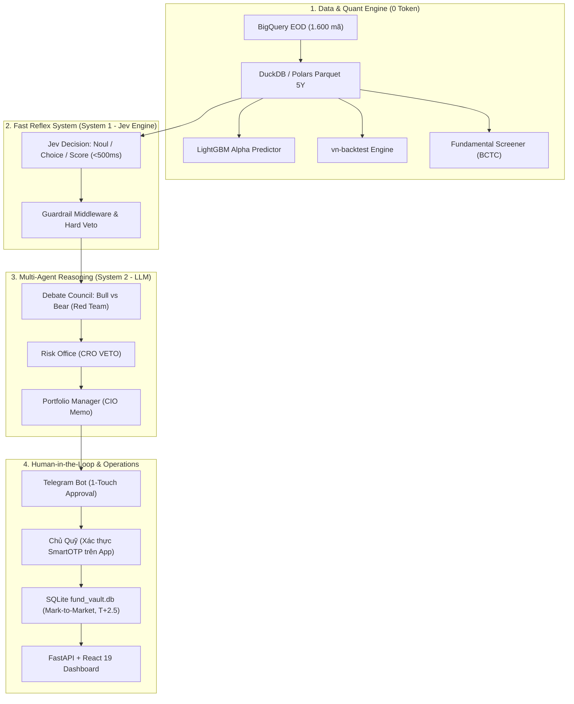

# 🏛️ QUỸ ĐẦU TƯ CHỨNG KHOÁN CÁ NHÂN TỰ TRỊ (AI INVESTMENT FUND)
### Autonomous Multi-Agent Hedge Fund • Vietnam Stock Market (HOSE / HNX / UPCOM)

Hệ thống Quỹ đầu tư định lượng cá nhân vận hành tự động theo mô hình **Tổ chức Đa Tác tử (Multi-Agent Organization)**, kết hợp động cơ Backtest chuẩn sàn Việt Nam (`vn-backtest`), Kiến trúc 2 Sổ chiến lược độc lập (**Core-Satellite Dual Book**), Hệ thống phản xạ siêu tốc **Jev Decision Engine** (System 1), Cơ chế kiểm soát quyền hạn **Harness Guardrail Middleware & Verification Loop**, Cơ sở dữ liệu SQLite Mark-to-Market, Tương tác di động qua Telegram Bot, Web Dashboard Zero-Token (FastAPI + React 19) và Hạ tầng Machine Learning (LightGBM).

---

## 📑 MỤC LỤC
1. [Kiến Trúc & Triết Lý Vận Hành](#1-kiến-trúc--triết-lý-vận-hành)
2. [Cơ Cấu Tổ Chức & Nhân Sự AI (.agent)](#2-cơ-cấu-tổ-chức--nhân-sự-ai-agent)
3. [Cấu Trúc Thư Mục Hệ Thống](#3-cấu-trúc-thư-mục-hệ-thống)
4. [Cài Đặt & Chuẩn Bị Môi Trường](#4-cài-đặt--chuẩn-bị-môi-trường)
5. [Cấu Hình Hệ Thống (.env)](#5-cấu-hình-hệ-thống-env)
6. [Quy Trình Vận Hành Hằng Ngày (Daily SOPs)](#6-quy-trình-vận-hành-hằng-ngày-daily-sops)
7. [Hệ Thống Phản Xạ Jev Engine & Harness Guardrails](#7-hệ-thống-phản-xạ-jev-engine--harness-guardrails)
8. [Phòng Thí Nghiệm Chiến Lược & Tự Học (Backtest & Self-Healing Lab)](#8-phòng-thí-nghiệm-chiến-lược--tự-học-backtest--self-healing-lab)
9. [Hạ Tầng Machine Learning (Universal Quant Alpha Model)](#9-hạ-tầng-machine-learning-universal-quant-alpha-model)
10. [Khởi Chạy Web Dashboard & Docker Compose](#10-khởi-chạy-web-dashboard--docker-compose)
11. [Hệ Thống Kế Toán Quỹ & Quản Trị Đa Tài Khoản (Historical Vault)](#11-hệ-thống-kế-toán-quỹ--quản-trị-đa-tài-khoản-historical-vault)
12. [Bộ Kiểm Thử Hệ Thống (Test Suites - 54 Tests)](#12-bộ-kiểm-thử-hệ-thống-test-suites---54-tests)

---

## 1. KIẾN TRÚC & TRIẾT LÝ VẬN HÀNH



### 1.1 Triết lý Vận hành 0 Token (Zero-Token Architecture)
* 100% các tác vụ tính toán toán học, chỉ báo kỹ thuật, quét dữ liệu nến 5 năm, backtest, Mark-to-Market NAV, xếp hạng Machine Learning và phục vụ Web Dashboard đều chạy bằng **Python + DuckDB + Polars + SQLite** nội bộ.
* **Hoàn toàn miễn phí, tiêu tốn 0 token LLM.** LLM chỉ được đánh thức khi cần suy luận chiến lược chuyên sâu (Adversarial Debate, Báo cáo đầu tư CIO, Khám nghiệm sai lầm Post-Mortem).

### 1.2 Kiến trúc 2 Sổ Chiến Lược (Core-Satellite Dual-Book)
Hệ thống phân tách vốn rõ ràng thành 2 phân hệ độc lập:
* **Sổ CORE (Đầu tư Cơ bản Trung & Dài Hạn):**
  * Hạn mức tối đa: **70% tổng NAV**.
  * Hạn mức vị thế đơn lẻ: **Tối đa 25% NAV/mã**.
  * Ngưỡng cắt lỗ cứng: **-15.0%** (cho phép chịu đựng biến động chu kỳ và kiểm định nền giá).
* **Sổ QUANT (Giao dịch Ngắn Hạn & Xung Lượng):**
  * Hạn mức tối đa: **30% tổng NAV**.
  * Hạn mức vị thế đơn lẻ: **Tối đa 15% NAV/mã**.
  * Ngưỡng cắt lỗ cứng: **-7.0%** (cắt lỗ thần tốc, bảo toàn vốn, chống kẹp hàng).

### 1.3 Cơ Chế Phản Xạ Siêu Tốc (Jev AI System 1) & Kiểm Soát Quyền Hạn (Harness Guardrails)
* **Jev Decision Engine:** Sử dụng các Primitive quyết định phân biệt (`Noul` - True/False + Confidence, `Choice` - Định tuyến CORE vs QUANT vs IGNORE, `Score` - Điểm số rủi ro thực thi [0.0 - 1.0]) với thời gian phản hồi `< 500ms`.
* **Guardrail Middleware:** Bộ lọc chặn cứng (**Hard Veto**), tự động từ chối đề xuất lệnh nếu vi phạm hạn mức tỷ trọng, kích hoạt ngắt mạch khi sụt giảm vốn tuần quá **5.0%**, kiểm tra thanh khoản bắt buộc ($\text{ADTV}_{20} \ge 10\text{ Tỷ}$, $\text{ADV}_{20} \ge 100.000\text{ CP}$), trần tham gia thị trường $\le 2\%$ ADV, và bẫy kẹt sàn (Floor-lock).
* **Harness Verification Loop:** Vòng lặp kiểm định mã hóa tự động thẩm định chiến lược, phát hiện quá khớp (Overfitting), tự động sửa lỗi và lưu bài học thể chế vào `.agent/journals/`.

---

## 2. CƠ CẤU TỔ CHỨC & NHÂN SỰ AI (.agent)

| Phòng ban | Nhân sự AI | Trách nhiệm cốt lõi |
| :--- | :--- | :--- |
| **Ban Nghiên cứu & Phân tích** | `macro_analyst.md`<br>`fundamental_analyst.md`<br>`technical_analyst.md` | • Xác định chế độ thị trường (*Heavy Downtrend, Sideway, Bullish*).<br>• Phân tích BCTC, phát hiện bất thường kế toán, định giá DCF, P/E, P/B.<br>• Nhận diện Price Action, VSA, hỗ trợ/kháng cự, điểm nổ volume. |
| **Hội đồng Phản biện (Debate)** | `bull_advocate.md`<br>`bear_advocate.md` | • **Phe Bò:** Luận điểm tăng trưởng, kỳ vọng sinh lời $R:R \ge 2.5:1$.<br>• **Phe Gấu (Red Team):** Vạch lá tìm sâu, bới móc rủi ro pha loãng, nợ vay, thanh khoản, bẫy bull-trap. |
| **Ban Quản trị Rủi ro** | `risk_officer.md` (CRO) | • Nắm **Quyền Phủ Quyết Tuyệt Đối (VETO Power)**.<br>• Tính toán Position Sizing, khóa cứng Stop-loss, bảo vệ tài sản quỹ. |
| **Ban Điều hành & Quyết định**| `cio.md`<br>**Bạn (Human-in-the-Loop)** | • CIO tổng hợp biên bản phản biện 2 chiều, ký Tờ trình gửi Telegram.<br>• **Bạn giữ quyền sinh sát tối cao**, nhập mã OTP khớp lệnh trên app CTCK. |
| **Kế toán & Kiểm toán** | `fund_accountant.md`<br>`portfolio_auditor.md` | • Kế toán trưởng tự động: Mark-to-Market NAV hằng ngày, thuế 0.1%, phí 0.15%, quyền cổ tức NĐ 126.<br>• Kiểm toán viên: Đo độ trượt giá (Slippage), chủ trì khám nghiệm Post-Mortem khi dính cắt lỗ. |

---

## 3. CẤU TRÚC THƯ MỤC HỆ THỐNG (FULL STACK AI MONOREPO ARCHITECTURE)

```
AI Investment Fund/
├── .agent/                       # Não bộ tổ chức Multi-Agent & Knowledge Base
│   ├── agents/                   # 9 vị trí nhân sự AI chuyên trách (CIO, CRO, Bull/Bear...)
│   ├── rules/                    # Hiến chương Quỹ, Quy chế thực thi & Bộ hạn mức rủi ro
│   ├── workflows/                # 5 Quy trình SOP chuẩn (Morning, Debate, Execution, EOD, Post-Mortem)
│   ├── skills/                   # Kho Kỹ năng Chiến lược đầu tư (strategy-vsa-momentum, valuation-dcf)
│   └── journals/                 # Nhật ký Tiến hóa & Khám nghiệm thất bại (Post-Mortem Memos)
├── apps/                         # Toàn bộ Tầng Ứng dụng & Serving (Client Touchpoints & APIs)
│   ├── api/                      # Backend Dịch Vụ REST API & Web Server (FastAPI)
│   │   ├── main.py               # FastAPI Application phục vụ Dashboard & Data Contracts
│   │   └── static/reports/       # Biểu đồ tương tác Plotly HTML xuất từ vn-backtest
│   ├── bot/                      # Co-Pilot Di động: Telegram Bot 1-Touch Approval (/fill)
│   └── web/                      # Web Dashboard: React 19 + Vite + Tailwind CSS
├── ai_brain/                     # Hệ Thống Suy Luận & Phản Xạ AI (System 1 & System 2)
│   ├── engines/                  # Động cơ phản xạ Jev Decision (<500ms) & Tranh biện Bull/Bear
│   └── harness/                  # Khung Kiểm Soát An Toàn (Guardrail Veto, Verification Loop, Context)
├── core/                         # Động Cơ Định Lượng & Kế Toán Zero-Token (0 Token Engine)
│   ├── accounting/               # Quản trị sổ lệnh, danh mục, Mark-to-Market, thuế phí NĐ 126
│   ├── backtest/                 # Động cơ kiểm định vn-backtest, Report Adapter & Tối ưu hóa
│   ├── data/                     # Quản trị dữ liệu Parquet, BigQuery Sync, Intraday Feed & Importer
│   ├── quant/                    # Machine Learning (LightGBM Alpha Model) & Sàng lọc BCTC
│   └── scheduler/                # Bộ lập lịch tự động kích hoạt cronjob hàng ngày
├── config/                       # Cấu hình tham số hệ thống & môi trường (settings.py)
├── data/                         # Kho dữ liệu định lượng Parquet 5 năm & BCTC
├── database/                     # CSDL lưu trữ SQLite vĩnh viễn (fund_vault.db & schema.sql)
├── models/                       # Thư mục lưu trọng số mô hình Machine Learning (.joblib)
├── notebooks/                    # Jupyter Notebook huấn luyện trên Kaggle / Colab
├── tests/                        # 9 Bộ Test Suites kiểm thử tự động toàn diện (54 tests)
├── main.py                       # Bộ điều phối trung tâm (CLI Orchestrator)
├── pytest.ini                    # Cấu hình kiểm thử chuẩn hóa tự động nhận diện root path
├── Dockerfile                    # Multi-stage Containerization độc lập môi trường
├── docker-compose.yml            # Khởi chạy toàn bộ hệ thống bằng 1 câu lệnh
└── requirements.txt              # Danh sách thư viện Python đồng bộ
```

---

## 4. CÀI ĐẶT & CHUẨN BỊ MÔI TRƯỜNG

### Cách 1: Chạy trực tiếp trên máy tính (macOS / Linux / Windows WSL2)

1. **Yêu cầu:** Python 3.11 hoặc 3.12, Node.js v18+.
2. **Cài đặt thư viện Python:**
   ```bash
   python3 -m venv .venv
   source .venv/bin/activate  # Trên Windows: .venv\Scripts\activate
   pip install -r requirements.txt
   ```
3. **Cài đặt và Build Frontend Dashboard:**
   ```bash
   cd apps/web
   npm install
   npm run build
   cd ../..
   ```

### Cách 2: Khởi chạy bằng Docker Compose (Khuyên dùng cho Server / VPS)
```bash
docker compose up -d --build
```

---

## 5. CẤU HÌNH HỆ THỐNG (.env)

Tạo file `.env` từ file mẫu `.env.example`:
```bash
cp .env.example .env
```
Chỉnh sửa các tham số trong file `.env`:
```ini
# Vốn & Phí giao dịch
INITIAL_CAPITAL=1000000000.0   # Vốn khởi điểm: 1 tỷ VND
BROKER_FEE_RATE=0.0015         # Phí môi giới: 0.15%
SELL_TAX_RATE=0.0010           # Thuế bán chứng khoán: 0.10%

# Telegram Bot (Nhận đề xuất lệnh & Báo cáo NAV)
TELEGRAM_BOT_TOKEN="your_bot_token_from_botfather"
TELEGRAM_CHAT_ID="your_telegram_chat_id"

# Google BigQuery Data Warehouse
GCP_PROJECT_ID="ai-trading-system-496014"
GCP_DATASET="vn_stock"
GCP_RAW_PRICE_TABLE="raw_price"
GCP_ADJ_PRICE_TABLE="adj_price"
GOOGLE_APPLICATION_CREDENTIALS=".secrets/credentials.json"
```

---

## 6. QUY TRÌNH VẬN HÀNH HẰNG NGÀY (DAILY SOPS)

> 💡 **HỆ THỐNG MẶC ĐỊNH CHẠY TỰ ĐỘNG 100% QUA SCHEDULER:**
> Container `fund-scheduler` chạy ngầm 24/7 và kích hoạt đúng giờ (Thứ 2 đến Thứ 6):
> * **08:00 AM:** Morning Briefing & Jev AI Reflex Triage quét volume đột biến.
> * **15:30 PM:** Chốt sổ kế toán NAV (Mark-to-Market), xử lý quyền T+2.5 và bắn báo cáo lên Telegram.
> * **20:00 PM:** Rà soát và nhắc nhở đối soát các lệnh chờ khớp trong ngày.
> * **21:00 PM:** Đồng bộ BigQuery EOD tải nến mới nhất về file Parquet 5 năm.

### Các Lệnh Kích Hoạt Thủ Công Khi Cần (CLI):

#### 1. Kiểm tra trạng thái toàn diện của Quỹ:
```bash
python3 main.py --status
```

#### 2. Kích hoạt Morning Briefing & Sơ lọc Jev System 1:
```bash
python3 main.py --workflow morning
```

#### 3. Kích hoạt Hội đồng Tranh biện & Thẩm định đề xuất cho mã cụ thể:
```bash
# Tranh biện theo Sổ CORE (Cơ bản)
python3 main.py --workflow debate --ticker HPG --book CORE

# Tranh biện theo Sổ QUANT (Trading)
python3 main.py --workflow debate --ticker SSI --book QUANT
```

#### 4. Khớp lệnh thực tế qua Telegram Bot (`/fill`):
Khi đặt lệnh thực tế trên app CTCK xong, nhắn vào Telegram:
```text
/fill HPG 5000 28.2
khớp SSI 3000 giá 32.5
```
Hệ thống sẽ tự động bóc tách, trừ tiền mặt, cập nhật cổ phiếu và tính lại giá vốn bình quân gia quyền.

#### 5. Chốt sổ NAV cuối ngày (EOD):
```bash
python3 main.py --workflow eod
```

---

## 7. HỆ THỐNG PHẢN XẠ JEV ENGINE & HARNESS GUARDRAILS

### 7.1 Jev Decision Engine (System 1)
```python
from ai_brain.engines.jev_decision_engine import JevDecisionEngine

jev = JevDecisionEngine()
# Phân loại sự kiện nhị phân (<500ms, 0 Token)
triage = jev.triage_market_event("HPG", intraday_bar={"pct_change": 3.5, "vol_ratio": 1.8})
# Định tuyến chiến lược vào sổ phù hợp
book_choice = jev.route_strategy_book("HPG")
# Chấm điểm rủi ro thực thi [0.0 - 1.0]
risk_score = jev.score_execution_risk("HPG", "CORE", proposed_volume=5000, proposed_price=28.5)
```

### 7.2 Harness Guardrail Middleware & Hard Veto
Mọi đề xuất lệnh trước khi lưu vào sổ cái đều bắt buộc đi qua `GuardrailMiddleware`:
1. **Kiểm tra Circuit Breaker:** Nếu sụt giảm vốn tuần $\ge 5.0\%$, đóng băng toàn bộ mua mới.
2. **Kiểm tra Hạn mức Sổ:** Core max 25% NAV, Quant max 15% NAV.
3. **Bộ lọc Thanh khoản:** Bắt buộc $\text{ADTV}_{20} \ge 10\text{ Tỷ VND}$ và $\text{ADV}_{20} \ge 100.000\text{ CP}$.
4. **Kiểm soát Tác động Thị trường:** Khối lượng mua không vượt quá **2.0% của $\text{ADV}_{20}$**.
5. **Kiểm tra Khả dụng T+2.5:** Tuyệt đối cấm bán non khi cổ phiếu chưa về tài khoản.
6. **Kiểm tra Floor-lock:** Chặn bán hoảng loạn khi cổ phiếu bị dư bán sàn trắng bên mua.

---

## 8. PHÒNG THÍ NGHIỆM CHIẾN LƯỢC & TỰ HỌC (BACKTEST & SELF-HEALING LAB)

### 8.1 Quy Trình Đóng Gói Chiến Lược Thành Agent Skill
Chiến lược kế thừa từ `BaseFundStrategy` trong `backtest/strategy_template.py`, sử dụng chỉ báo Polars vector hóa.
Khi thẩm định, Hội đồng CRO áp dụng bộ tiêu chí khắt khe:
* ✅ Sharpe Ratio $\ge 1.20$
* ✅ Max Drawdown $\le 15.00\%$
* ✅ Profit Factor $\ge 1.80$
* ✅ Tổng số giao dịch kiểm định $\ge 15$ lệnh

### 8.2 Động Cơ Tự Học & Tiến Hóa Sửa Sai (Auto-Healing)
Khi một chiến lược bị từ chối (`REJECTED`) hoặc dính Stop-loss, hệ thống tự động kích hoạt tiến hóa tham số:
```bash
python3 main.py --optimize vsa-momentum --ticker HPG
```
Cỗ máy sẽ:
1. Chẩn đoán nguyên nhân thất bại định lượng (`diagnose_failure`).
2. Quét lưới tham số đa chiều (`ParameterOptimizer`).
3. Tái đóng gói phiên bản **v2.0** với bảng đối sánh Trước/Sau.
4. Xuất Biên bản Khám nghiệm sai lầm (`post_mortem_*.md`) vào `.agent/journals/`.

---

## 9. HẠ TẦNG MACHINE LEARNING (UNIVERSAL QUANT ALPHA MODEL)

* **Thuật toán:** LightGBM Classifier, tối ưu hóa theo phương pháp Walk-Forward Cross-Validation.
* **Ma trận Đặc trưng:** 15 đặc trưng kỹ thuật phi tuyến tính (RSI, Bollinger Bands, Volatility, Volume Ratio, Price Momentum, MA cross...).
* **Gán nhãn Triple-Barrier:** Xác định nhãn dựa trên rào cản Lãi mục tiêu, Cắt lỗ và Giới hạn thời gian nắm giữ (5 phiên).
* **Tốc độ Suy Luận:** `< 0.005 giây/mã`, hỗ trợ chấm điểm Alpha Score hàng loạt cho toàn bộ danh mục VN30.

---

## 10. KHỞI CHẠY WEB DASHBOARD & DOCKER COMPOSE

Khởi chạy máy chủ Dashboard:
```bash
python3 main.py --serve-dashboard
```
Mở trình duyệt truy cập: **`http://localhost:8000`**

Các tính năng nổi bật trên Web Dashboard:
* **Nút [Đồng Bộ Giá BigQuery]:** Cập nhật giá đóng cửa EOD mới nhất từ Google BigQuery chỉ với 1 click.
* **Bộ Lọc Đa Tài Khoản (Account Pills):** Chuyển đổi linh hoạt giữa Toàn quỹ (`ALL`), Tài khoản hiện hành (`0001716319`), hoặc các tài khoản cũ (`009C105992`, `127008`).
* **Thẻ Tổng Quan Tài Sản:** NAV chuẩn hóa Mark-to-Market, Daily PnL, Lợi nhuận lũy kế bóc tách Realized / Unrealized.
* **Machine Learning Studio:** Trích xuất 15 đặc trưng, tải dataset CSV, tải lên mô hình `.joblib` đã huấn luyện từ Kaggle/Colab.
* **Báo cáo Chiến lược:** Xem biểu đồ đường cong vốn Plotly HTML tương tác trực quan.

---

## 11. HỆ THỐNG KẾ TOÁN QUỸ & QUẢN TRỊ ĐA TÀI KHOẢN (HISTORICAL VAULT)

Hệ thống quản lý nguồn vốn thực tế thông qua việc tái hiện (**Replay**) **1.710 giao dịch lịch sử từ 16/06/2016 đến nay** qua 4 tài khoản CTCK:
* **Giá vốn bình quân (WAC):** Tự động gộp phí mua vào giá vốn, khấu trừ cổ tức tiền mặt, điều chỉnh pha loãng cổ phiếu thưởng kèm thuế TNCN 5% theo Nghị định 126/2020/NĐ-CP.
* **Nguyên tắc Vốn Gốc Không Âm:** Phân tách rạch ròi giữa Thu hồi vốn gốc (Return of Capital) và Rút lợi nhuận về tài khoản ngân hàng (Profit Distribution).
* **Quy tắc Thận trọng cho Cổ phiếu Treo Sàn:** Cổ phiếu bị đình chỉ/hủy niêm yết (như `FLC`) được tự động định giá thị giá = **`0,00 đ`**, bảo toàn sự trung thực tuyệt đối của NAV thật.

Lệnh nạp/tái hiện lịch sử:
```bash
python3 tools/transaction_importer.py
```

---

## 12. BỘ KIỂM THỬ HỆ THỐNG (TEST SUITES - 54 TESTS)

Hệ thống sở hữu bộ kiểm thử tự động toàn diện gồm **9 test suites với 54 bài test** bao phủ 100% các phân hệ nghiệp vụ.

Chạy toàn bộ test suites chỉ với 1 câu lệnh duy nhất:
```bash
PYTHONPATH=. pytest
```

| Bộ Kiểm Thử | Tệp Test | Số Test | Nội Dung Xác Minh |
| :--- | :--- | :---: | :--- |
| **Dual-Book & Hội Đồng** | `tests/test_dual_book_committee.py` | 18 | Phân định Sổ CORE vs QUANT, tỷ trọng danh mục, quy chế tranh biện Bull/Bear, quyền VETO của CRO. |
| **Phản Xạ Jev & Harness** | `tests/test_harness_and_jev.py` | 12 | Primitive Noul, Choice, Score, Guardrail Middleware Hard Veto, Verification Loop & Auto-Healing. |
| **Quản Trị Rủi Ro Chuyên Sâu** | `tests/test_risk_refinements.py` | 8 | Sụt giảm vốn tuần 5%, thanh khoản ADTV20 $\ge$ 10 tỷ, trần tỷ lệ tham gia thị trường 2% ADV, bẫy floor-lock. |
| **Machine Learning Pipeline** | `tests/test_ml_pipeline.py` | 6 | Trích xuất 15 đặc trưng, gán nhãn 3 rào cản, huấn luyện LightGBM, Walk-Forward Validation, Alpha Score. |
| **Kế Toán Quỹ Lịch Sử** | `tests/test_historical_accounting.py`| 4 | Replay 1.710 giao dịch lịch sử, cân bằng số dư 4 tài khoản, cổ tức NĐ 126, vốn gốc không âm. |
| **Tiến Hóa & Tự Học** | `tests/test_evolution.py` | 3 | Chẩn đoán nguyên nhân thất bại, quét lưới ParameterOptimizer, tự khắc phục chiến lược v2.0. |
| **Cơ Sở Dữ Liệu SQLite** | `tests/test_phase1.py` | 1 | Khởi tạo schema 6 bảng, nạp Parquet, khớp lệnh mua/bán, tính thuế phí và chốt sổ NAV daily. |
| **Động Cơ vn-backtest** | `tests/test_phase2.py` | 1 | Kiểm định chu kỳ T+2.5, bước giá trần/sàn, lô chẵn 100, tạo Skill và xuất biểu đồ Plotly HTML. |
| **Giao Tiếp & Dashboard API** | `tests/test_phase3.py` | 1 | Tin nhắn Telegram 2 chiều Bull/Bear, bóc tách regex `/fill`, và các REST API của Dashboard. |

---

🏛️ **Hệ thống Quỹ Đầu tư AI sẵn sàng vận hành an toàn, minh bạch, kỷ luật thép và hoàn toàn tự chủ!**
