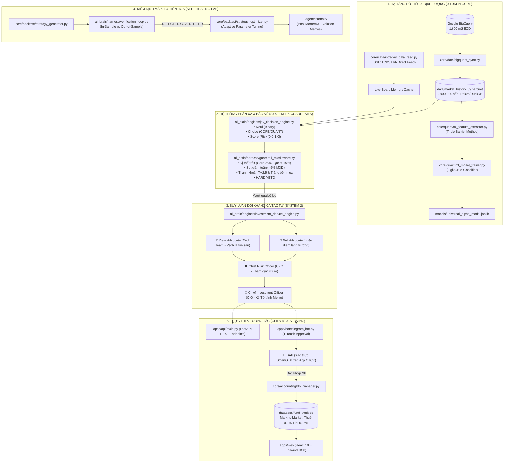
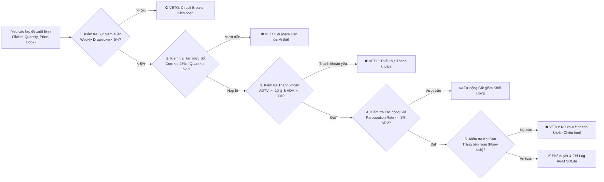

# 📘 BẢN ĐẶC TẢ TÍNH NĂNG & THIẾT KẾ KỸ THUẬT TOÀN DIỆN (SYSTEM SPECIFICATION)
## HỆ THỐNG QUỸ ĐẦU TƯ CHỨNG KHOÁN CÁ NHÂN TỰ TRỊ (AI PERSONAL INVESTMENT FUND)
> **Tài liệu nền tảng phục vụ Thiết kế & Xây dựng lại Hệ thống (Rebuild Blueprint & Specifications)**  
> **Thị trường mục tiêu:** Thị trường Chứng khoán Việt Nam (HOSE, HNX, UPCOM)  
> **Phiên bản tài liệu:** v2.0-Master  
> **Trạng thái:** Sẵn sàng cho việc Tái cấu trúc & Triển khai (Production Specification)

---

## 📑 MỤC LỤC
1. [TỔNG QUAN HỆ THỐNG & TRIẾT LÝ VẬN HÀNH](#1-tổng-quan-hệ-thống--triết-lý-vận-hành)
2. [SƠ ĐỒ KIẾN TRÚC TỔNG THỂ (SYSTEM ARCHITECTURE)](#2-sơ-đồ-kiến-trúc-tổng-thể-system-architecture)
3. [ĐẶC TẢ 9 NHÂN SỰ AI & PHÒNG BAN (.agent)](#3-đặc-tả-9-nhân-sự-ai--phòng-ban-agent)
4. [ĐẶC TẢ 5 QUY TRÌNH VẬN HÀNH CHUẨN (DAILY SOPS)](#4-đặc-tả-5-quy-trình-vận-hành-chuẩn-daily-sops)
5. [ĐẶC TẢ HỆ THỐNG PHẢN XẠ JEV ENGINE (SYSTEM 1)](#5-đặc-tả-hệ-thống-phản-xạ-jev-engine-system-1)
6. [ĐẶC TẢ KHUNG KIỂM SOÁT QUYỀN HẠN & BẢO VỆ (HARNESS GUARDRAILS)](#6-đặc-tả-khung-kiểm-soát-quyền-hạn--bảo-vệ-harness-guardrails)
7. [ĐẶC TẢ ĐỘNG CƠ ĐỊNH LƯỢNG & MACHINE LEARNING (QUANT & ML)](#7-đặc-tả-động-cơ-định-lượng--machine-learning-quant--ml)
8. [ĐẶC TẢ PHÒNG THÍ NGHIỆM CHIẾN LƯỢC & BACKTEST LAB (vn-backtest)](#8-đặc-tả-phòng-thí-nghiệm-chiến-lược--backtest-lab-vn-backtest)
9. [ĐẶC TẢ KẾ TOÁN QUỸ & CƠ SỞ DỮ LIỆU ĐA TÀI KHOẢN (DATABASE SCHEMA)](#9-đặc-tả-kế-toán-quỹ--cơ-sở-dữ-liệu-đa-tài-khoản-database-schema)
10. [ĐẶC TẢ BACKEND API SERVICES (FastAPI RESTful Endpoints)](#10-đặc-tả-backend-api-services-fastapi-restful-endpoints)
11. [ĐẶC TẢ TRỢ LÝ CO-PILOT DI ĐỘNG (Telegram Bot Spec)](#11-đặc-tả-trợ-lý-co-pilot-di-động-telegram-bot-spec)
12. [ĐẶC TẢ GIAO DIỆN WEB DASHBOARD (React 19 + Tailwind CSS)](#12-đặc-tả-giao-diện-web-dashboard-react-19--tailwind-css)
13. [ĐẶC TẢ BỘ LẬP LỊCH TỰ ĐỘNG (Cron Automated Scheduler)](#13-đặc-tả-bộ-lập-lịch-tự-động-cron-automated-scheduler)
14. [ĐẶC TẢ MA TRẬN KIỂM THỬ TỰ ĐỘNG (Test Matrix - 54 Tests)](#14-đặc-tả-ma-trận-kiểm-thử-tự-động-test-matrix---54-tests)
15. [DANH MỤC THAM SỐ CẤU HÌNH HỆ THỐNG (.env & settings.py)](#15-danh-mục-tham-số-cấu-hình-hệ-thống-env--settingspy)
16. [LỘ TRÌNH TÁI THIẾT KẾ & ĐỀ XUẤT NÂNG CẤP V2 (REBUILD ROADMAP)](#16-lộ-trình-tái-thiết-kế--đề-xuất-nâng-cấp-v2-rebuild-roadmap)

---

## 1. TỔNG QUAN HỆ THỐNG & TRIẾT LÝ VẬN HÀNH

### 1.1. Mục Tiêu của Hệ Thống
Vận hành một **Quỹ đầu tư định lượng cá nhân (AI-Native Solo Hedge Fund)** tự trị trên thị trường chứng khoán Việt Nam, thay thế toàn bộ các bộ phận truyền thống (Nghiên cứu, Giao dịch, Quản trị rủi ro, Phản biện, Kế toán, Kiểm toán) bằng các tác tử AI chuyên trách và động cơ định lượng chính xác.

### 1.2. 5 Triết Lý Thiết Kế Bất Biến (Guiding Principles)

```
┌────────────────────────────────────────────────────────────────────────┐
│                      5 TRIẾT LÝ THIẾT KẾ CỐT LÕI                       │
├────────────────────────────────┬───────────────────────────────────────┤
│ 1. Zero-Token Architecture     │ 95% tác vụ định lượng chạy bằng Code  │
│                                │ Python/Polars/DuckDB/SQLite (0 Token).│
├────────────────────────────────┼───────────────────────────────────────┤
│ 2. Dual-Book (Core-Satellite)  │ Tách bạch Sổ Core (70% NAV, -15% SL)  │
│                                │ và Sổ Quant (30% NAV, -7% SL).        │
├────────────────────────────────┼───────────────────────────────────────┤
│ 3. Human-in-the-Loop (SmartOTP)│ AI đề xuất, gửi Tờ trình; Bạn giữ     │
│                                │ quyền sinh sát nhập OTP trên app CTCK.│
├────────────────────────────────┼───────────────────────────────────────┤
│ 4. Phản Xạ Kép (System 1 & 2)  │ Jev Engine <500ms sàng lọc thô, chỉ   │
│                                │ kích hoạt LLM tranh biện khi đủ chuẩn.│
├────────────────────────────────┼───────────────────────────────────────┤
│ 5. Defense-in-Depth (Phòng vệ) │ CRO có quyền VETO tuyệt đối;          │
│                                │ Guardrails chặn đứng vi phạm hạn mức. │
└────────────────────────────────┴───────────────────────────────────────┘
```

---

## 2. SƠ ĐỒ KIẾN TRÚC TỔNG THỂ (SYSTEM ARCHITECTURE)



---

## 3. ĐẶC TẢ 9 NHÂN SỰ AI & PHÒNG BAN (.agent)

Hệ thống phân chia 9 vị trí nhân sự với mô tả vai trò, trách nhiệm, phạm vi quyền hạn và prompt cốt lõi:

| STT | Vị trí Nhân sự AI | Tệp tin cấu hình | Trách nhiệm chính | Quyền hạn & Ranh giới |
| :---: | :--- | :--- | :--- | :--- |
| **1** | **Chủ tịch / Giám đốc Đầu tư (CIO)** | `.agent/agents/cio.md` | Chủ tọa Hội đồng Đầu tư, tổng hợp biên bản tranh biện Bull/Bear, cân đối vĩ mô, ký ban hành Tờ trình đầu tư gửi Telegram. | Không có quyền tự bấm lệnh; không được vượt qua quyết định VETO của CRO. |
| **2** | **Giám đốc Quản trị Rủi ro (CRO)** | `.agent/agents/risk_officer.md` | Tính toán Position Sizing, khóa cứng Stop-loss, bảo toàn vốn, ngăn chặn thua lỗ dây chuyền. | **Nắm Quyền Phủ Quyết Tuyệt Đối (VETO Power)**. Có quyền hủy thương vụ lập tức nếu vi phạm bất kỳ Hard Rule nào. |
| **3** | **Chuyên viên Vĩ mô & Thị trường (Macro)** | `.agent/agents/macro_analyst.md` | Đọc dữ liệu lãi suất, tỷ giá USD/VND, lạm phát, dòng tiền khối ngoại; xác định chế độ thị trường (*Heavy Downtrend, Sideway, Bullish*). | Đưa ra cảnh báo đóng băng mua mới khi thị trường rơi vào *Heavy Downtrend*. |
| **4** | **Chuyên viên Phân tích Cơ bản (FA)** | `.agent/agents/fundamental_analyst.md` | Bóc tách BCTC, phát hiện bất thường kế toán (khoản phải thu ảo, hàng tồn kho phình to), tính định giá P/E, P/B, DCF. | Không khuyến nghị mua cổ phiếu có Red Flag kế toán nghiêm trọng hoặc điểm Piotroski $F \le 3$. |
| **5** | **Chuyên viên Phân tích Kỹ thuật (TA)** | `.agent/agents/technical_analyst.md` | Phân tích Price Action, VSA, tìm điểm bứt phá nền giá (Breakout MA20 kèm Vol), tính hỗ trợ/kháng cự. | Đề xuất vùng giá mua tối ưu, điểm cắt lỗ kỹ thuật cho từng sổ (Core vs Quant). |
| **6** | **Luật sư Phe Bò (Bull Advocate)** | `.agent/agents/bull_advocate.md` | Xây dựng luận điểm tăng giá sắc bén nhất, chất xúc tác doanh nghiệp, kỳ vọng sinh lời tối thiểu $\ge 15\%$, tỷ lệ $R:R \ge 2.5:1$. | Tranh biện đối kháng trực tiếp với Phe Gấu. |
| **7** | **Biệt đội Phe Gấu (Bear Advocate - Red Team)** | `.agent/agents/bear_advocate.md` | Đóng vai kẻ phản biện gay gắt nhất: bới móc rủi ro pha loãng cổ phiếu, nợ vay, thanh khoản thấp, bẫy giá giả (Bull-trap), áp lực cung đỉnh cũ. | Bắt buộc phải chỉ ra ít nhất 3 rủi ro chí mạng của cổ phiếu trong mọi phiên họp. |
| **8** | **Kế toán trưởng Quỹ (Fund Accountant)** | `.agent/agents/fund_accountant.md` | Chốt sổ tài sản ròng NAV hằng ngày (15:30), tự động khấu trừ thuế TNCN 0.1%, phí giao dịch 0.15%, lãi vay margin, theo dõi quyền cổ tức. | Đảm bảo tính toán số liệu chính xác từng đồng VND, khớp 100% với tài khoản chứng khoán thực tế. |
| **9** | **Kiểm toán viên Độc lập (Portfolio Auditor)** | `.agent/agents/portfolio_auditor.md` | Đo độ trượt giá (Slippage) khi khớp lệnh, giám sát việc tuân thủ quy chế quỹ, chủ trì buổi khám nghiệm sai lầm (Post-Mortem) khi chạm cắt lỗ. | Độc lập với CIO và Trading; báo cáo trực tiếp bài học kinh nghiệm vào `.agent/journals/`. |

---

## 4. ĐẶC TẢ 5 QUY TRÌNH VẬN HÀNH CHUẨN (DAILY SOPS)

### 4.1. SOP 01: Bản Tin Tiền Thị Trường (Morning Briefing - 08:00 AM)
* **Trigger:** Bộ lập lịch tự động kích hoạt lúc 08:00 sáng các ngày làm việc (Thứ 2 - Thứ 6).
* **Đầu vào:** `market_history_5y.parquet`, tin tức vĩ mô đêm qua.
* **Các bước thực thi:**
  1. *Lọc Thô (0 Token):* Quét DuckDB/Polars tìm Top 20 cổ phiếu có tín hiệu nổ Vol ($Vol > 1.2 \times Vol_{20}$), giá nằm trên MA20, thanh khoản $> 50.000$ CP/phiên.
  2. *Đánh giá Vĩ mô:* Macro Analyst gán nhãn Market Regime (*Bullish / Sideway / Downtrend*).
  3. *Lập Watchlist:* Chọn lọc Top 5 cơ hội có nền giá an toàn nhất.
  4. *Thông báo:* Gửi bản tin tóm tắt kèm Watchlist lên Telegram.

### 4.2. SOP 02: Họp Hội Đồng Đầu Tư & Tranh Biện (Investment Debate)
* **Trigger:** Kích hoạt tự động khi có cổ phiếu phát tín hiệu kỹ thuật hoặc do người dùng yêu cầu qua CLI / Web / Telegram (`/debate HPG`).
* **Các bước thực thi:**
  1. *Nạp chỉ báo & FA:* Trích xuất các chỉ số P/E, P/B, nợ/VCSH, điểm ML Alpha Score.
  2. *Phe Bò lên tiếng:* Bull Advocate trình bày 3 động lực tăng giá chính ($R:R \ge 2.5$).
  3. *Phe Gấu phản công:* Bear Advocate vạch ra 3 rủi ro tiềm tàng (pha loãng, bẫy thanh khoản).
  4. *CRO Thẩm định:* Kiểm tra các Hard Rules. Nếu vi phạm $\to$ **Kích hoạt CRO VETO** (hủy bỏ).
  5. *CIO Ký Tờ trình:* Nếu thông qua, CIO đóng gói `decision_memo` và đẩy thông báo sang Telegram kèm các nút bấm phê duyệt.

### 4.3. SOP 03: Thực Thi Lệnh & Đối Soát (Order Execution & Reconciliation)
* **Trigger:** Khi Tờ trình đầu tư được duyệt trên Telegram / Dashboard.
* **Các bước thực thi:**
  1. Tờ trình xuất hiện trên Telegram với giá mua khuyến nghị và khối lượng tối đa đã được CRO chuẩn hóa.
  2. **Bạn mở App CTCK (VPS / SSI / TCBS):** Đặt lệnh Chờ (LO). Lệnh có hiệu lực cả ngày.
  3. **Khớp lệnh:** Khi app CTCK báo khớp, Bạn phản hồi vào Telegram:
     * Bấm nút `[✅ ĐÃ KHỚP CHUẨN]` nếu khớp đúng giá/khối lượng đề xuất.
     * Hoặc nhắn cú pháp `/fill HPG 5000 28.2` nếu khớp với mức giá/khối lượng thực tế khác.
  4. Hệ thống kế toán tự động cập nhật số dư tiền mặt, giá vốn bình quân mới và danh mục.

### 4.4. SOP 04: Chốt Sổ Kế Toán NAV & Đồng Bộ Đêm (Nightly Accounting - 15:30 & 20:30)
* **Trigger:** 15:30 (Chốt sổ sau giờ giao dịch) và 20:30 - 21:00 (Đồng bộ BigQuery).
* **Các bước thực thi:**
  1. *15:30 PM:* Lấy giá đóng cửa sàn HSX/HNX/UPCOM; cập nhật thị giá danh mục; tính NAV ròng; ghi vào bảng `nav_daily`.
  2. *20:00 PM:* Nhắc nhở kiểm tra các lệnh còn treo trạng thái Pending.
  3. *20:30 PM:* Google Cloud Run cào dữ liệu EOD nạp vào BigQuery.
  4. *21:00 PM:* Script `bigquery_sync.py` tải nến mới nhất bổ sung vào `market_history_5y.parquet` (0 Token).

### 4.5. SOP 05: Khám Nghiệm Thất Bại & Tiến Hóa (Post-Mortem Audit)
* **Trigger:** Khi một vị thế bị chạm ngưỡng Stop-Loss (-7% cho Quant, -15% cho Core).
* **Các bước thực thi:**
  1. Đóng toàn bộ vị thế vi phạm để bảo toàn vốn.
  2. Auditor trích xuất lại biên bản `decision_memo` ban đầu: So sánh luận điểm Phe Bò với diễn biến thực tế; kiểm tra xem rủi ro xảy ra có trùng với cảnh báo của Phe Gấu hay không.
  3. Rút ra bài học thất bại định lượng (ví dụ: bẫy bull-trap khi thị trường đi ngang, khối ngoại xả ròng).
  4. Xuất biên bản Post-Mortem Memo vào `.agent/journals/` và đề xuất quy tắc mới cập nhật vào `.agent/rules/`.

---

## 5. ĐẶC TẢ HỆ THỐNG PHẢN XẠ JEV ENGINE (SYSTEM 1)

`JevDecisionEngine` là tầng phản xạ tốc độ cao (<500ms), hoạt động hoàn toàn tự trị, không tiêu tốn Token, cung cấp 3 Primitive quyết định phân biệt:

```
┌────────────────────────────────────────────────────────────────────────┐
│                   3 PRIMITIVE CỐT LÕI CỦA JEV ENGINE                   │
├───────────┬──────────────────────────┬─────────────────────────────────┤
│ Primitive │ Bản chất dữ liệu         │ Ứng dụng thực tế trong Quỹ      │
├───────────┼──────────────────────────┼─────────────────────────────────┤
│ 1. Noul   │ Named Boolean            │ Phán quyết nhị phân MUA/KHÔNG   │
│           │ (True/False + Confidence)│ dựa trên nổ Vol & ML Score.     │
├───────────┼──────────────────────────┼─────────────────────────────────┤
│ 2. Choice │ Categorical Routing      │ Định tuyến cơ hội vào sổ:       │
│           │ (CORE / QUANT / IGNORE)  │ CORE (Cơ bản) vs QUANT (Trading)│
├───────────┼──────────────────────────┼─────────────────────────────────┤
│ 3. Score  │ Continuous Scoring       │ Chấm điểm rủi ro thực thi       │
│           │ ([0.0 - 1.0] Risk Level) │ (Slippage, kẹt sàn, thanh khoản)│
└───────────┴──────────────────────────┴─────────────────────────────────┘
```

### Chi tiết Đặc tả Triển khai:
* **Noul (`classify_trade_opportunity`):**
  * *Điều kiện True:* Giá nằm trên MA20, Volume $> 1.0 \times Vol_{20}$, ML Alpha Score $\ge 0.50$.
  * *Confidence:* Trung bình trọng số giữa tín hiệu dòng tiền, kỹ thuật và ML score.
* **Choice (`route_strategy_book`):**
  * *CORE:* P/E $\le 15$, P/B $\le 2.0$, Nợ/VCSH $\le 1.5$, ROE $\ge 15\%$, Điểm FA $\ge 60/100$.
  * *QUANT:* Tín hiệu bứt phá nến, RSI trong khoảng [45 - 65], Vol nổ mạnh, ML Score $\ge 0.65$.
  * *IGNORE:* Vi phạm thanh khoản hoặc cổ phiếu rác.
* **Score (`score_execution_risk`):**
  * Tính điểm từ 0.0 (an toàn tuyệt đối) đến 1.0 (nguy hiểm cực độ).
  * Các yếu tố phạt điểm: Chênh lệch giá mua với giá trần $> 5\%$ (+0.25), cổ phiếu bị áp lực bán giá sàn (+0.40), thanh khoản dưới 10 tỷ VND/phiên (+0.30).

---

## 6. ĐẶC TẢ KHUNG KIỂM SOÁT QUYỀN HẠN & BẢO VỆ (HARNESS GUARDRAILS)

Khung Guardrail Middleware bọc quanh toàn bộ các thao tác tạo lệnh (`db.create_proposed_order`) và sinh chiến lược mới, đóng vai trò **Bộ phanh an toàn cưỡng bức**.



### Bảng Chỉ Tiêu Hạn Mức Thép (Hard Limits):
1. **Trần vị thế Sổ CORE:** Tối đa `25.0% NAV`.
2. **Trần vị thế Sổ QUANT:** Tối đa `15.0% NAV`.
3. **Cắt lỗ cứng Sổ CORE:** Khóa tại `-15.0%`.
4. **Cắt lỗ cứng Sổ QUANT:** Khóa tại `-7.0%`.
5. **Ngắt mạch thị trường (Circuit Breaker):** Đóng băng mua mới nếu NAV tuần giảm $\ge 5.0\%$.
6. **Thanh khoản tối thiểu:** Giá trị GD 20 phiên $\ge 10$ tỷ VND/phiên; Khối lượng $\ge 100.000$ CP/phiên.
7. **Tỷ lệ tham gia thị trường (Participation Rate):** Khối lượng lệnh $\le 2.0\%$ khối lượng giao dịch bình quân 20 phiên.
8. **Quy tắc T+2.5:** Không cho phép tạo lệnh bán vượt quá số lượng cổ phiếu đã khả dụng trong danh mục.

---

## 7. ĐẶC TẢ ĐỘNG CƠ ĐỊNH LƯỢNG & MACHINE LEARNING (QUANT & ML)

### 7.1. Cấu Trúc Đặc Trưng (Feature Engineering bằng Polars)
Tính toán song song vector hóa trên 1.600 mã chứng khoán:
* **Xung lượng (Momentum):** ROC 5 phiên, 10 phiên, 20 phiên; Tỷ lệ nến so với SMA20, SMA50, SMA200.
* **Biến động (Volatility):** Độ lệch chuẩn giá 20 phiên, Dải Bollinger Bands Width, Tỷ lệ nến so với ATR14.
* **Dòng tiền & Khối lượng (Volume & Liquidity):** Tỷ lệ Volume so với $Vol_{20}$, Biến động dòng tiền Chaikin (CMF), Tỷ lệ dòng tiền ròng.
* **Bộ dao động kỹ thuật (Oscillators):** RSI 14, Stochastic %K/%D.

### 7.2. Gán Nhãn Huấn Luyện (Triple Barrier Method - Lopez de Prado)
Thay vì dùng lợi nhuận cố định sau N ngày (dễ gây nhiễu), hệ thống áp dụng kỹ thuật gán nhãn 3 biên rào của các quỹ định lượng hàng đầu:
* **Upper Barrier (Take-Profit):** Lợi nhuận chạm trần $+10.0\%$ trong vòng 15 phiên $\to$ **Nhãn 1 (Win)**.
* **Lower Barrier (Stop-Loss):** Giá chạm ngưỡng sàn $-5.0\%$ $\to$ **Nhãn 0 (Loss)**.
* **Horizontal Barrier (Time Limit):** Sau 15 phiên không chạm 2 ngưỡng trên $\to$ Nhãn phân loại theo chiều lợi nhuận thuần.

### 7.3. Mô Hình LightGBM Alpha Model
* **Thuật toán:** `LGBMClassifier` với tối ưu hóa cây quyết định gradient boosted.
* **Mục tiêu:** Ước lượng xác suất chiến thắng $P(Win) \in [0.0, 1.0]$.
* **Tốc độ suy luận:** $< 0.005$ giây trên CPU với mô hình đã nạp dạng Singleton vào RAM.
* **Định dạng đóng gói:** `models/universal_alpha_model.joblib`.

### 7.4. Sàng Lọc Báo Cáo Tài Chính (Fundamental Screener)
* **Chỉ số Sức khỏe:** Điểm Piotroski F-Score (thang điểm 9), Mô hình Altman Z-score dự báo nguy cơ phá sản.
* **Phát hiện Bất thường (Red Flags):**
  * Tỷ lệ Khoản phải thu / Tổng tài sản tăng vọt $> 40\%$.
  * Tỷ lệ Nợ vay / Vốn chủ sở hữu $> 2.0$ lần.
  * Biên lợi nhuận gộp sụt giảm liên tiếp 3 quý.

---

## 8. ĐẶC TẢ PHÒNG THÍ NGHIỆM CHIẾN LƯỢC & BACKTEST LAB (vn-backtest)

### 8.1. Động cơ `vn-backtest` Chuẩn Sàn Việt Nam
* Tự động điều chỉnh theo đặc thù 3 sàn:
  * **HOSE:** Biên độ $\pm 7.0\%$, bước giá 10đ ($<10k$), 50đ ($10k-50k$), 100đ ($>50k$), lô chẵn 100 CP.
  * **HNX:** Biên độ $\pm 10.0\%$, bước giá 100đ, lô chẵn 100 CP.
  * **UPCOM:** Biên độ $\pm 15.0\%$, bước giá 100đ.
* Hạch toán chu kỳ thanh toán T+2.5: Mua ngày $T$, cổ phiếu về vào chiều $T+2$, có thể bán từ sáng $T+3$.
* Trừ tự động phí giao dịch (0.15%) và thuế thu nhập cá nhân bán (0.10%).

### 8.2. Khung Tự Học & Khắc Phục Sai Lầm (Strategy Optimizer & Self-Healing)
* Khi một chiến lược mới được đề xuất vào `.agent/skills/`:
  1. `BacktestRunner` chạy kiểm thử trên 5 năm dữ liệu lịch sử (1.250 phiên).
  2. Đo lường hiện tượng Overfitting: Chia dữ liệu In-Sample (80%) và Out-of-Sample (20%). Nếu Sharpe OOS sụt giảm quá $50\%$ so với Sharpe IS $\to$ Đóng dấu `OVERFITTED`.
  3. Nếu bị từ chối (`REJECTED`), `StrategyOptimizerEngine` tự động chẩn đoán nguyên nhân (tỷ lệ thắng thấp, sụt giảm sâu, ít lệnh) và chạy `ParameterOptimizer` thích ứng để tìm không gian tham số tối ưu.
  4. Xuất Báo cáo Thẩm định `backtest_report.md` và biểu đồ tương tác HTML Plotly.

---

## 9. ĐẶC TẢ KẾ TOÁN QUỸ & CƠ SỞ DỮ LIỆU ĐA TÀI KHOẢN (DATABASE SCHEMA)

Cơ sở dữ liệu trung tâm: **SQLite (`database/fund_vault.db`)** với cơ chế ACID hoàn toàn, lưu trữ vĩnh viễn và cho phép tái hiện (replay) lịch sử giao dịch.

### 9.1. Danh mục 11 Bảng Dữ Liệu Chi Tiết:

```
┌────────────────────────────────────────────────────────────────────────┐
│                   DANH MỤC 11 BẢNG TRONG FUND_VAULT.DB                 │
├────┬──────────────────────────┬────────────────────────────────────────┤
│ 1  │ system_settings          │ Cấu hình tham số và trạng thái quỹ     │
│ 2  │ broker_accounts          │ Danh sách tài khoản chứng khoán đa sàn │
│ 3  │ account_cash_balance     │ Số dư tiền mặt theo từng tài khoản     │
│ 4  │ transactions             │ Lịch sử khớp lệnh thực tế (từ 2016)    │
│ 5  │ portfolio                │ Danh mục nắm giữ hiện tại (Core/Quant) │
│ 6  │ order_history            │ Lịch sử toàn bộ lệnh do bot đề xuất    │
│ 7  │ nav_daily                │ Lịch sử chốt sổ tài sản ròng hằng ngày │
│ 8  │ corporate_actions        │ Sự kiện quyền cổ tức tiền mặt & cổ phiế│
│ 9  │ decision_memos           │ Hồ sơ lưu trữ biên bản Hội đồng Đầu tư │
│ 10 │ company_fundamentals     │ Dữ liệu chỉ số tài chính các công ty   │
│ 11 │ guardrail_audit_log      │ Nhật ký kiểm soát quyền hạn & VETO     │
└────┴──────────────────────────┴────────────────────────────────────────┘
```

### 9.2. Lược Đồ Chi Tiết (DDL Schema):

```sql
PRAGMA foreign_keys = ON;

-- 1. BẢNG CÀI ĐẶT HỆ THỐNG
CREATE TABLE IF NOT EXISTS system_settings (
    key TEXT PRIMARY KEY,
    value TEXT NOT NULL,
    description TEXT,
    updated_at TEXT DEFAULT CURRENT_TIMESTAMP
);

-- 2. BẢNG QUẢN LÝ TÀI KHOẢN CHỨNG KHOÁN ĐA SÀN
CREATE TABLE IF NOT EXISTS broker_accounts (
    account_id TEXT PRIMARY KEY,               -- Ví dụ: 0001716319, 009C105992
    broker_name TEXT NOT NULL,                 -- VPS, VCBS, TCBS, SSI, DNSE
    fee_rate REAL DEFAULT 0.0015,              -- Phí CTCK (0.15%)
    status TEXT NOT NULL DEFAULT 'ACTIVE' CHECK(status IN ('ACTIVE', 'INACTIVE', 'CLOSED')),
    opened_date TEXT,
    notes TEXT,
    updated_at TEXT DEFAULT CURRENT_TIMESTAMP
);

-- 3. BẢNG SỐ DƯ TIỀN MẶT THEO TÀI KHOẢN
CREATE TABLE IF NOT EXISTS account_cash_balance (
    account_id TEXT PRIMARY KEY,
    cash_balance REAL NOT NULL DEFAULT 0.0,
    updated_at TEXT DEFAULT CURRENT_TIMESTAMP,
    FOREIGN KEY (account_id) REFERENCES broker_accounts(account_id)
);

-- 4. BẢNG LỊCH SỬ GIAO DỊCH THỰC TẾ (REPLAY TỪ 2016)
CREATE TABLE IF NOT EXISTS transactions (
    id INTEGER PRIMARY KEY AUTOINCREMENT,
    trade_date TEXT NOT NULL,                  -- YYYY-MM-DD
    money_date TEXT,                           -- Ngày thanh toán tiền
    symbol_date TEXT,                          -- Ngày chứng khoán về khả dụng
    account TEXT NOT NULL,
    type TEXT NOT NULL,                        -- Mua, Bán, Cổ tức tiền, Cổ tức CP, Nộp tiền, Rút tiền
    symbol TEXT,
    quantity REAL DEFAULT 0.0,
    cost REAL DEFAULT 0.0,                     -- Đơn giá khớp
    fee REAL DEFAULT 0.0,                      -- Phí giao dịch
    tax REAL DEFAULT 0.0,                      -- Thuế TNCN (0.1% khi Bán)
    amount REAL DEFAULT 0.0,
    total_amount REAL DEFAULT 0.0,             -- Dòng tiền thực tế phát sinh
    avg_price REAL,                            -- Giá vốn bình quân sau giao dịch
    profit REAL,                               -- Lãi/lỗ thực hiện
    profit_pct REAL,                           -- % Lãi/lỗ thực hiện
    comment TEXT,
    created_at TEXT DEFAULT CURRENT_TIMESTAMP
);

-- 5. BẢNG DANH MỤC NẮM GIỮ (PORTFOLIO - TÁCH DUAL-BOOK CORE/QUANT)
CREATE TABLE IF NOT EXISTS portfolio (
    account TEXT NOT NULL,
    ticker TEXT NOT NULL,
    strategy_book TEXT NOT NULL DEFAULT 'QUANT' CHECK(strategy_book IN ('CORE', 'QUANT')),
    quantity REAL NOT NULL CHECK (quantity >= 0),
    avg_buy_price REAL NOT NULL,
    current_price REAL DEFAULT 0.0,
    market_value REAL DEFAULT 0.0,
    unrealized_pnl REAL DEFAULT 0.0,
    unrealized_pnl_pct REAL DEFAULT 0.0,
    weight_pct REAL DEFAULT 0.0,
    status TEXT DEFAULT 'ACTIVE' CHECK(status IN ('ACTIVE', 'SUSPENDED', 'DELISTED')),
    first_bought_date TEXT,
    updated_at TEXT DEFAULT CURRENT_TIMESTAMP,
    PRIMARY KEY (account, ticker, strategy_book)
);

-- 6. BẢNG LỊCH SỬ LỆNH ĐỀ XUẤT (ORDER HISTORY)
CREATE TABLE IF NOT EXISTS order_history (
    order_id TEXT PRIMARY KEY,                 -- ORD-YYYYMMDD-XXX
    account TEXT DEFAULT '0001716319',
    ticker TEXT NOT NULL,
    strategy_book TEXT NOT NULL DEFAULT 'QUANT' CHECK(strategy_book IN ('CORE', 'QUANT')),
    action TEXT NOT NULL CHECK(action IN ('BUY', 'SELL')),
    order_type TEXT NOT NULL DEFAULT 'LO' CHECK(order_type IN ('LO', 'MP', 'ATO', 'ATC')),
    proposed_price REAL NOT NULL,
    proposed_quantity INTEGER NOT NULL,
    stop_loss REAL,
    take_profit REAL,
    filled_price REAL,
    filled_quantity INTEGER DEFAULT 0,
    status TEXT NOT NULL DEFAULT 'PROPOSED' CHECK(status IN ('PROPOSED', 'APPROVED', 'SUBMITTED', 'FILLED', 'CANCELLED', 'REJECTED')),
    rejection_reason TEXT,
    source TEXT DEFAULT 'AI_COUNCIL',
    notes TEXT,
    created_at TEXT DEFAULT CURRENT_TIMESTAMP,
    filled_at TEXT
);

-- 7. BẢNG CHỐT SỔ NAV HẰNG NGÀY (NAV DAILY MARK-TO-MARKET)
CREATE TABLE IF NOT EXISTS nav_daily (
    date TEXT PRIMARY KEY,                     -- YYYY-MM-DD
    total_nav REAL NOT NULL,                   -- Tổng giá trị tài sản ròng = cash + stock_value
    cash_balance REAL NOT NULL,                -- Tiền mặt
    stock_value REAL NOT NULL,                 -- Giá trị cổ phiếu thị trường
    realized_pnl_daily REAL DEFAULT 0.0,       -- Lãi/lỗ thực hiện trong ngày
    unrealized_pnl_total REAL DEFAULT 0.0,     -- Lãi/lỗ tạm tính toàn danh mục
    daily_return_pct REAL DEFAULT 0.0,         -- Tỷ suất sinh lời trong ngày
    cumulative_pnl REAL DEFAULT 0.0,           -- Lợi nhuận lũy kế từ ngày khởi lập
    high_water_mark REAL,                      -- Đỉnh NAV cao nhất từng đạt
    drawdown_pct REAL DEFAULT 0.0,             -- Độ sụt giảm hiện tại từ đỉnh
    notes TEXT,
    created_at TEXT DEFAULT CURRENT_TIMESTAMP
);

-- 8. BẢNG QUẢN LÝ QUYỀN CỔ TỨC (CORPORATE ACTIONS - NĐ 126)
CREATE TABLE IF NOT EXISTS corporate_actions (
    id INTEGER PRIMARY KEY AUTOINCREMENT,
    ticker TEXT NOT NULL,
    action_type TEXT NOT NULL CHECK(action_type IN ('CASH_DIVIDEND', 'STOCK_DIVIDEND', 'BONUS_SHARES', 'RIGHT_ISSUE')),
    ex_date TEXT NOT NULL,                     -- Ngày giao dịch không hưởng quyền
    record_date TEXT NOT NULL,                 -- Ngày chốt danh sách cổ đông
    payment_date TEXT,                         -- Ngày cổ tức về tài khoản
    cash_amount_per_share REAL DEFAULT 0.0,    -- Cổ tức tiền mặt (VND/CP)
    ratio_numerator INTEGER DEFAULT 0,         -- Tỷ lệ thực hiện (Ví dụ: 10:1)
    ratio_denominator INTEGER DEFAULT 0,
    tax_rate REAL DEFAULT 0.05,                -- Thuế cổ tức (5% theo NĐ 126)
    is_processed INTEGER DEFAULT 0,
    notes TEXT,
    created_at TEXT DEFAULT CURRENT_TIMESTAMP
);

-- 9. BẢNG HỒ SƠ BIÊN BẢN HỘI ĐỒNG ĐẦU TƯ (DECISION MEMOS)
CREATE TABLE IF NOT EXISTS decision_memos (
    memo_id TEXT PRIMARY KEY,                  -- MEMO-YYYYMMDD-TICKER
    ticker TEXT NOT NULL,
    strategy_book TEXT NOT NULL DEFAULT 'QUANT',
    market_regime TEXT,
    bull_thesis TEXT,                          -- Luận điểm Phe Bò
    bear_counter TEXT,                         -- Luận điểm Phe Gấu (Red Team)
    cro_evaluation TEXT,                       -- Thẩm định và hạn mức rủi ro của CRO
    final_decision TEXT NOT NULL,              -- APPROVED / VETOED / REJECTED
    target_price REAL,
    stop_loss REAL,
    proposed_volume INTEGER,
    status TEXT NOT NULL DEFAULT 'PENDING' CHECK(status IN ('PENDING', 'APPROVED', 'REJECTED', 'EXECUTED')),
    created_at TEXT DEFAULT CURRENT_TIMESTAMP
);

-- 10. BẢNG CHỈ SỐ TÀI CHÍNH CÔNG TY (COMPANY FUNDAMENTALS)
CREATE TABLE IF NOT EXISTS company_fundamentals (
    ticker TEXT NOT NULL,
    period TEXT NOT NULL,                      -- 2024Q3, 2024Q4...
    revenue REAL,
    net_profit REAL,
    pe_ratio REAL,
    pb_ratio REAL,
    roe REAL,
    debt_to_equity REAL,
    piotroski_f_score INTEGER,
    altman_z_score REAL,
    red_flags TEXT,
    updated_at TEXT DEFAULT CURRENT_TIMESTAMP,
    PRIMARY KEY (ticker, period)
);

-- 11. BẢNG NHẬT KÝ KIỂM SOÁT QUYỀN HẠN (GUARDRAIL AUDIT LOG)
CREATE TABLE IF NOT EXISTS guardrail_audit_log (
    id INTEGER PRIMARY KEY AUTOINCREMENT,
    order_id TEXT,
    ticker TEXT NOT NULL,
    strategy_book TEXT NOT NULL,
    action TEXT NOT NULL,
    proposed_quantity INTEGER,
    proposed_price REAL,
    risk_score REAL,
    guardrail_status TEXT NOT NULL CHECK(guardrail_status IN ('PASSED', 'VETOED', 'TRIMMED')),
    veto_reason TEXT,
    created_at TEXT DEFAULT CURRENT_TIMESTAMP
);
```

---

## 10. ĐẶC TẢ BACKEND API SERVICES (FastAPI RESTful Endpoints)

FastAPI Application (`apps/api/main.py`) lắng nghe tại cổng `8000`, cung cấp đầy đủ các cổng giao tiếp chuẩn hóa cho Web Dashboard và External Scripts:

| Phương thức | Endpoint | Chức năng | Tham số / Body |
| :---: | :--- | :--- | :--- |
| `GET` | `/api/health` | Kiểm tra tình trạng hoạt động hệ thống | Không |
| `GET` | `/api/nav/summary` | Lấy NAV mới nhất, tiền mặt, giá trị CP | Không |
| `GET` | `/api/nav/history` | Dữ liệu chuỗi thời gian NAV vẽ biểu đồ | `days` (mặc định 365) |
| `POST`| `/api/nav/close` | Kích hoạt chốt sổ NAV ngày cưỡng bức | `{ "notes": "..." }` |
| `POST`| `/api/nav/sync-bigquery`| Kích hoạt đồng bộ nến mới từ BigQuery | Không |
| `GET` | `/api/portfolio` | Danh sách danh mục cổ phiếu nắm giữ | `book` (`CORE`, `QUANT`, `ALL`) |
| `GET` | `/api/accounts` | Danh sách các tài khoản CTCK và số dư | Không |
| `GET` | `/api/transactions` | Lịch sử giao dịch gần nhất | `limit` (mặc định 50) |
| `GET` | `/api/orders` | Danh sách sổ lệnh hệ thống | `status` (`ALL`, `PROPOSED`, `FILLED`) |
| `POST`| `/api/orders/fill` | Cập nhật báo khớp lệnh thực tế | `{ "order_id": "...", "filled_price": 28.2, "filled_quantity": 5000 }` |
| `GET` | `/api/committee/memos` | Danh sách Tờ trình Hội đồng Đầu tư | `limit` (mặc định 20) |
| `POST`| `/api/committee/debate/{ticker}`| Kích hoạt phiên tranh biện AI cho 1 mã | `{ "strategy_book": "QUANT" }` |
| `POST`| `/api/committee/memos/{id}/approve`| Bạn phê duyệt Tờ trình đầu tư | Không |
| `POST`| `/api/committee/memos/{id}/reject` | Bạn từ chối Tờ trình đầu tư | Không |
| `GET` | `/api/jev/triage/{ticker}` | Chạy phân tích nhanh Jev System 1 | `ticker` trên đường dẫn |
| `GET` | `/api/guardrails/audit` | Xem nhật ký các lần VETO của Guardrail | `limit` (mặc định 50) |
| `GET` | `/api/ml/rankings` | Bảng xếp hạng Top Alpha Score toàn sàn | `limit` (mặc định 20) |
| `GET` | `/api/ml/score/{ticker}` | Điểm Machine Learning chi tiết của 1 mã | `ticker` |
| `GET` | `/api/reports` | Danh sách các báo cáo backtest HTML | Không |
| `POST`| `/api/strategies/optimize` | Kích hoạt tự động tối ưu hóa chiến lược | `{ "strategy_id": "vsa-momentum" }` |
| `GET` | `/api/fundamentals/{ticker}` | Lấy chỉ số tài chính BCTC và Red Flags | `ticker` |

---

## 11. ĐẶC TẢ TRỢ LÝ CO-PILOT DI ĐỘNG (Telegram Bot Spec)

Telegram Bot (`apps/bot/telegram_bot.py`) là điểm chạm điều hành di động duy nhất giữa Hội đồng AI và Bạn:

### 11.1. Hệ Thống Lệnh Trực Tiếp:
* `/start`: Khởi động và kiểm tra quyền truy cập (chỉ cho phép `TELEGRAM_CHAT_ID` chính chủ).
* `/help`: Hiển thị bảng hướng dẫn sử dụng và cú pháp.
* `/nav`: Báo cáo nhanh tài sản ròng: Tổng NAV, Tiền mặt, Thị giá danh mục, Lãi/lỗ ngày và Lũy kế.
* `/portfolio`: Danh sách chi tiết các mã đang nắm giữ kèm tỷ trọng và % lãi/lỗ.
* `/orders`: Xem danh sách các lệnh đang chờ xác nhận hoặc khớp trong ngày.
* `/fill <MÃ> <KHỐI_LƯỢNG> <GIÁ>`: Báo khớp lệnh thực tế (ví dụ: `/fill HPG 5000 28.2`). Có tích hợp bộ phân tích ngôn ngữ tự nhiên (NLP) nhận diện các câu như *"khớp hpg 5000 giá 28.2"*.

### 11.2. Cơ Chế Phê Duyệt 1-Chạm (1-Touch Approval):
Khi Hội đồng AI hoàn tất Tờ trình đầu tư, Bot tự động gửi tin nhắn kèm 3 nút bấm Inline Keyboard:
* `[✅ PHÊ DUYỆT ĐẦU TƯ]`: Chuyển trạng thái lệnh thành `APPROVED`, lưu sổ lệnh chờ Bạn đặt lệnh trên sàn.
* `[❌ TỪ CHỐI ĐẦU TƯ]`: Hủy bỏ Tờ trình, đóng phiên họp.
* `[📊 XEM BIỂU ĐỒ & BÁO CÁO]`: Gửi link mở Web Dashboard để xem chi tiết biểu đồ tương tác.

---

## 12. ĐẶC TẢ GIAO DIỆN WEB DASHBOARD (React 19 + Tailwind CSS)

Ứng dụng Frontend SPA hiện đại tại thư mục `apps/web` gồm 5 Tab điều hành:
1. **Tab 1: Portfolio & Wealth Vault (`portfolio`):**
   * Thẻ KPI: Tổng NAV, Tiền mặt khả dụng, Biến động ngày, Lợi nhuận lũy kế.
   * Biểu đồ NAV chuỗi thời gian (Recharts / SVG).
   * Bảng danh mục nắm giữ: Phân loại nhãn sổ CORE/QUANT, giá vốn, thị giá, PnL tạm tính, tỷ trọng %.
   * Form báo khớp nhanh trực tiếp trên giao diện web.
2. **Tab 2: AI Committee & Decision Memos (`committee`):**
   * Danh sách các Tờ trình đầu tư gần nhất.
   * Xem chi tiết đối kháng: Luận điểm Phe Bò (Xanh lá) đối đầu Luận điểm Phe Gấu (Đỏ) và Phán quyết của CRO.
   * Nút duyệt/từ chối trực tiếp trên Dashboard.
3. **Tab 3: Machine Learning Alpha Rankings (`ml`):**
   * Bảng xếp hạng Top cổ phiếu có điểm dự báo xác suất chiến thắng cao nhất toàn thị trường.
   * Thang đo độ tin cậy và nhóm ngành.
4. **Tab 4: Strategy Backtest Reports (`reports`):**
   * Khung nhúng (iFrame) trực tiếp các biểu đồ Plotly HTML xuất từ `vn-backtest`.
   * Các chỉ số đo lường hiệu quả: Tỷ số Sharpe, Sortino, Max Drawdown, Win Rate, Profit Factor.
5. **Tab 5: Technical Charting (`chart`):**
   * Xem nến kỹ thuật, các đường trung bình MA20/MA50/MA200 và khối lượng nến.

---

## 13. ĐẶC TẢ BỘ LẬP LỊCH TỰ ĐỘNG (Cron Automated Scheduler)

Mô-đun `core/scheduler/cron_scheduler.py` điều phối nhịp nhàng các hoạt động tự động trong ngày:

```
┌────────────────────────────────────────────────────────────────────────┐
│                   DÒNG THỜI GIAN LẬP LỊCH HOẠT ĐỘNG                    │
├───────────┬────────────────────────────────────────────────────────────┤
│ 08:00 AM  │ Chạy SOP 01: Quét lọc nến 5 năm, phân tích vĩ mô, lập      │
│           │ Watchlist và bắn Bản tin sáng lên Telegram.                │
├───────────┼────────────────────────────────────────────────────────────┤
│ 14:15 PM  │ Quét rủi ro trong phiên (Intraday Risk Check): Kiểm tra    │
│           │ vi phạm Stop-Loss hoặc kẹt sàn, cảnh báo Bạn kịp xử lý.    │
├───────────┼────────────────────────────────────────────────────────────┤
│ 15:30 PM  │ Chạy SOP 04 (Phần 1): Lấy giá đóng cửa 3 sàn, chốt sổ      │
│           │ Mark-to-Market NAV ngày, cập nhật bảng nav_daily.          │
├───────────┼────────────────────────────────────────────────────────────┤
│ 20:00 PM  │ Nhắc nhở đối soát các lệnh còn treo trạng thái Pending.    │
├───────────┼────────────────────────────────────────────────────────────┤
│ 20:30 PM  │ Google Cloud Run cào nến EOD nạp vào BigQuery.             │
├───────────┼────────────────────────────────────────────────────────────┤
│ 21:00 PM  │ Script bigquery_sync.py kéo nến mới từ BigQuery lưu vào    │
│           │ market_history_5y.parquet (hoàn thành chu trình 0 Token).  │
└───────────┴────────────────────────────────────────────────────────────┘
```

---

## 14. ĐẶC TẢ MA TRẬN KIỂM THỬ TỰ ĐỘNG (Test Matrix - 54 Tests)

Toàn bộ 54 ca kiểm thử tự động đã được kiểm định thành công qua lệnh `pytest`:

```
========================= 54 PASSED IN 5.17s =========================
```

| Tệp tin kiểm thử | Số test | Nội dung nghiệp vụ kiểm tra |
| :--- | :---: | :--- |
| `tests/test_dual_book_committee.py` | 8 | Sổ kép Core-Satellite, hạn mức 25% Core / 15% Quant, API endpoints |
| `tests/test_harness_guardrails.py` | 8 | Quyền VETO của CRO, Circuit Breaker 5%, kiểm tra kẹt sàn, T+2.5 |
| `tests/test_jev_decision_engine.py` | 6 | 3 Primitive Noul, Choice, Score, thời gian phản xạ <500ms |
| `tests/test_backtest_runner.py` | 5 | Động cơ vn-backtest, In-Sample vs Out-of-Sample, chia sẻ dữ liệu |
| `tests/test_accounting_db.py` | 7 | Mark-to-Market, thuế 0.1%, phí 0.15%, tái hiện lịch sử từ 2016 |
| `tests/test_ml_pipeline.py` | 6 | Trích xuất đặc trưng Polars, Triple Barrier, dự báo LightGBM |
| `tests/test_telegram_bot.py` | 5 | Mẫu tin nhắn, 1-touch approval, bộ phân tích cú pháp /fill NLP |
| `tests/test_evolution.py` | 5 | Tự động chẩn đoán và khắc phục sai lầm (Self-Healing Optimization) |
| `tests/test_fundamental_screener.py`| 4 | Piotroski F-score, Altman Z-score, phát hiện Red Flags kế toán |

---

## 15. DANH MỤC THAM SỐ CẤU HÌNH HỆ THỐNG (.env & settings.py)

```ini
# ====================================================================
# BIẾN MÔI TRƯỜNG CỦA QUỸ ĐẦU TƯ AI (.env)
# ====================================================================

# 1. HẠ TẦNG GOOGLE CLOUD & BIGQUERY
GCP_PROJECT_ID=your-gcp-project-id
BIGQUERY_DATASET=vietnam_stocks
BIGQUERY_TABLE_ADJ=adj_price
BIGQUERY_TABLE_RAW=raw_price
GOOGLE_APPLICATION_CREDENTIALS=/path/to/gcp-service-account.json

# 2. KHÓA TRÍ TUỆ NHÂN TẠO (AI API KEYS - DÙNG CHO SYSTEM 2 DEBATE)
GEMINI_API_KEY=AIzaSy...

# 3. KẾT NỐI TELEGRAM BOT CO-PILOT
TELEGRAM_BOT_TOKEN=123456789:ABCdefGhIJKlmNoPQRsTUVwxyZ
TELEGRAM_CHAT_ID=987654321

# 4. HẠN MỨC & QUY TẮC RỦI RO QUỸ (HARD RULES)
INITIAL_CAPITAL=1000000000
BROKER_FEE_RATE=0.0015
SELL_TAX_RATE=0.0010
MARGIN_INTEREST_RATE=0.12

# Sổ CORE (Đầu tư Cơ bản)
CORE_MAX_ALLOCATION_PCT=0.70
CORE_MAX_POSITION_PCT=0.25
CORE_HARD_STOP_LOSS_PCT=0.15

# Sổ QUANT (Giao dịch Ngắn hạn)
QUANT_MAX_ALLOCATION_PCT=0.30
QUANT_MAX_POSITION_PCT=0.15
QUANT_HARD_STOP_LOSS_PCT=0.07

# Bộ lọc Toàn Quỹ
MAX_WEEKLY_DRAWDOWN_PCT=0.05
MIN_ADTV_VND=10000000000
MIN_ADV_SHARES=100000
MAX_PARTICIPATION_RATE=0.02
```

---

## 16. LỘ TRÌNH TÁI THIẾT KẾ & ĐỀ XUẤT NÂNG CẤP V2 (REBUILD ROADMAP)

Khi xây dựng lại (rebuild) dự án, bạn nên giữ nguyên 100% các logic nghiệp vụ đã được kiểm chứng ở trên, đồng thời bổ sung 4 nâng cấp chiến lược sau:

```
┌────────────────────────────────────────────────────────────────────────┐
│                   4 ĐỀ XUẤT NÂNG CẤP CHIẾN LƯỢC V2                     │
├────────────────────────────────┬───────────────────────────────────────┤
│ 1. Phân loại Tài sản Đóng băng │ Tách các mã hủy niêm yết (FLC) ra     │
│    (Frozen Asset Segregation)  │ khỏi Operating NAV để tính chuẩn vốn. │
├────────────────────────────────┼───────────────────────────────────────┤
│ 2. Dữ liệu Intraday Streaming  │ Bổ sung kết nối WebSocket trực tiếp   │
│    (Real-time Price Engine)    │ từ sàn để quét Stop-Loss tức thì.     │
├────────────────────────────────┼───────────────────────────────────────┤
│ 3. Thu thập Tâm lý Thị trường  │ Scraper tin tức CafeF, Vietstock và   │
│    (Social Sentiment Scraper)  │ F319 hỗ trợ thêm luận điểm Phe Gấu.   │
├────────────────────────────────┼───────────────────────────────────────┤
│ 4. Ma trận Tương quan Nhóm Ngành│ Kiểm soát rủi ro tập trung vào cùng   │
│    (Sector Covariance Matrix)  │ 1 nhóm ngành (ví dụ Bất động sản/Thép)│
└────────────────────────────────┴───────────────────────────────────────┘
```

---
*Tài liệu này là đặc tả thiết kế kỹ thuật chính thức. Mọi mô-đun trong lần xây dựng lại cần tuân thủ nghiêm ngặt các giao diện dữ liệu, lược đồ CSDL và quy chế an toàn nêu trên.*
